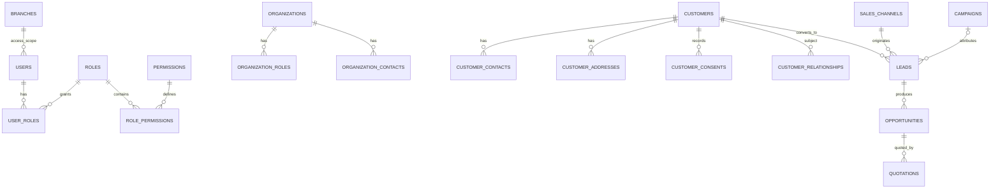
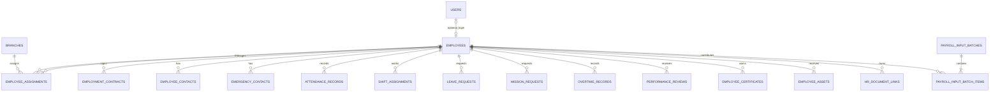
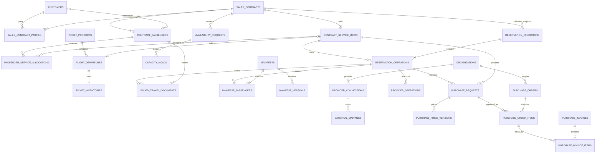
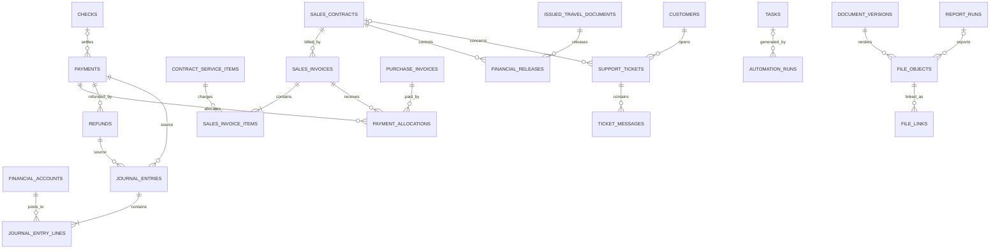

## Sales-declared receipt destination — 2026-10-27

SalesContractPaymentEntry has nullable destinationAccountId (real restrictive FK to FinanceSettlementAccount) and destinationAccountTitle (canonical title at entry). Migration20261027160000 is additive and leaves existing payments NULL. Finance owns the public masked choice and active/branch/currency validation boundary; Sales validates atomically before payment insertion. This is the declared destination only, independent of financeReceiptAccountId and receipt approval. No balances, journal, receipt allocation or release changes until ordinary Finance approval. New optional API fields remain compatible with older clients; apply migration/API before Web and retain nullable columns on rollback.

## Additional hotel room category — 2026-10-27

SalesContractHotelStayRoom.roomCategory is nullable varchar16 with the same SINGLE, DOUBLE, DOUBLE_EXTRA, TRIPLE and FAMILY values as the primary hotel room category. The additive migration leaves legacy records NULL; no historic category is inferred or backfilled. Sales accepts an optional compatible roomCategory in each additional-stay room and preserves previously saved categories when an older client omits them for the same room identity and compatible composition. Apply migration before the new API; retain the column on rollback. Child ages remain the existing JSON array (ages 0–1 represent infants), with draft-only unknown child ages blocked before submission. No price, hotel identity, existing contract or reservation workflow is rewritten.
## Composite hotel contract stays — 2026-10-26

MasterCompositeHotelMember retains actual Hotel FKs and unique ordered priorities; members may span cities. MasterCompositeHotel.cityId is derived from the first member for compatibility. SalesContractHotelSelection remains the primary room/price reference. Its optional additionalStays relation uses SalesContractHotelStay, with UUID parent/Hotel/City FKs, historical name varchar240, independent DATE boundaries and ordinal2..50. Unique(parent, ordinal), ordered-parent, hotel/date and city index prefixes cover reads/FK maintenance. DB CHECKs enforce positive stays and ordinal bounds; Sales enforces actual city ownership, distinct hotel IDs, max50 total and chronological nonoverlap. No invented dates, prices, bookings or historical backfill. Omission on compatible updates preserves itinerary; explicit[] removes it. Retain new storage on rollback; older writers must not edit multistay contracts. Migration20261026120000 is additive and has not been applied to production.

## Country manual GMT offset — 2026-10-21

MasterCountry.gmtOffset is nullable varchar6, canonical signed HH:MM from -12:00 through +14:00 with minute precision. Blank clears; omitted PATCH preserves; legacy countries remain NULL without guessed backfill. This is descriptive reference metadata, not IANA/DST or flight-time authority. Migration20261021120000 adds only a nullable column and matching CHECK with bounded lock wait. Retain column on application rollback. No operational apply/deployment authorized.

## Facility import lossless text — 2026-10-21

MasterFacility.name widens from varchar160 to varchar500 without changing identities, relations or existing indices. Import preview and final revalidation enforce PostgreSQL character counts and all persisted hotel/reference string limits; accepted facility text is never truncated. Boundary500 with four-byte characters plus an80-character category is verified against the actual compound indexes. Migration20261021100000_facility_name_text is widening-only; retain it on application rollback and never narrow after longer names have been saved. No cross-module ownership/API changes. See tasks/HOTEL-FACILITY-TEXT-1021.md.

## Hotel import optional identity/website/free-sale — 2026-10-20

MasterHotel.freeSale is nullable Boolean reference metadata, independent of isActive, isSaleableReference and sourceFeatured; NULL means unspecified and false must remain false. No backfill or availability/payment policy change. Existing name stores optional Persian name (hotel-name fallback), englishName stores the workbook hotel name, and website keeps its existing nullable320-character text field. An omitted new header on import UPDATE preserves saved values; explicit blanks clear nullable website/freeSale. Generic authorized profile edits preserve omitted fields and audit/version behavior. Apply additive migration20261020180000_hotel_free_sale before API/Web rollout; no operational migration was performed by implementation. Older14/18-column workbooks remain valid.

## Manual per-unit toman reference — 2026-10-18

MasterCurrency.tomanPerUnit is an independent nullable Decimal(24,10):1 unit of
the row currency=N tomans. Positive finite decimal string; blank clears to NULL.
The new form/table uses this value only. Legacy unitsPerUsd remains unchanged
with its original meaning and is never automatically converted/backfilled.
This reference does not alter purchase FX, settlements or ledger balances.

## Partner360 and manual USD reference rate — 2026-10-17

MasterCurrency.unitsPerUsd is nullable Decimal(24,10), exposed as a decimal string
through existing Master Data v1 attributes. It means1USD=N record-currency units;
IRR is rials, not tomans. Positive finite values only; USD itself must equal1.
Omission preserves, blank clears, CAS/audit remains mandatory. No automatic FX
snapshot, financial approval, existing transaction or historical rate is changed.

Existing B2B organization/branch/role unique identity now accepts SUPPLIER and
BROKER separately from AGENCY/CORPORATE_CUSTOMER. Credit flows COUNTERPARTY_TO_US.
New Finance requests may reference actual MasterOrganization plus its supported
role through restrictive FKs and a pair CHECK. Legacy free-text parties remain
unlinked; never backfill by name. The composite lookup starts with organization,
role and branch. Existing role rows survive identity edits; referenced roles
cannot be removed. Immutable payment revisions stay in Finance; purchases are
read through Reservations/Procurement public producers, with per-currency Decimal
totals, invoice-version ownership and fail-closed reconciliation.

## Flight total purchase allocation (FLIGHT-TOTAL-CONTRACT-COST-1013)

No storage change: the existing invoiceAmount stores the exact whole-flight purchase; unitCost is its four-decimal per-seat display equivalent. The additive totalCost command is mutually exclusive with unitCost; existing unit commands remain valid. Finance's public recorded-cost projection adds seatCount and invoiceAmount. Sales uses exact invoice × assigned seat count / purchased seat count, rounded once per contract/flight; legacy age-specific records retain prior behavior. Total and unit command retries use the existing canonical invoice/seat fingerprint, CAS and payment lock. Settled-cost publication policy is unchanged.

## ACCOUNTING-DOCUMENTS-PARITY-1011

Finance owns AccountingGeneralDocument, its immutable Member and Line relations, and migration20261011184000. Headers are scoped to book/period; a journal belongs to at most one general document and must be posted in the same book/period. Lines reference actual GENERAL accounts through composite book FKs and aggregate base debit/credit without creating additional journal effects. Generation uses a fresh versioned checksum under the book lock. Date edits check member dates, the next general document and intervening journals; journal saves after issuance enforce the general-document cutoff. Applied only to the isolated test database, not main Rubi.

Journal number uniqueness is scoped to (bookId, periodId, number); a partial unique index retains book-wide uniqueness for legacy null-period drafts. Migration20261011173000 changes only indexes, never historical numbers. New source memorandum/temporary saves allocate MAX(number)+1 in their actual period under the existing book row lock, while preserving the legacy book serial counter for old flows. Period numbering verifies complete filtered membership and versions within one open period and leaves final document numbers intact. No main-runtime migration applied yet.

Finance owns the additive nullable AccountingTemplateLine.role (SOURCE/TARGET for the observed automatic template grids; OFFSET/BASIS for the observed revaluation grids) and AccountingTemplate.attributes JSON for server-authored structural metadata and notes. Existing side, percentage and include semantics and composite book/account/detail FKs remain intact. Legacy rows retain null role and are never reinterpreted as observed-source templates. Producer Finance snapshot and Finance Web consumer share optional v1 fields. Apply the additive migration before the API; no source financial records are imported.

Finance also owns additive MEMORANDUM in the journal status CHECK and v1 union. Existing statuses and historical rows remain unchanged. The observed document commands distinguish incomplete memorandum saves from balanced temporary DRAFT saves; conversion is versioned and audited in the existing transaction. Memorandums cannot submit, review or post, and remain excluded from existing accounting report/numbering calculations. Recoverable deletion restores a memorandum to its original status from the actual deletion event. Apply migration20261011162000 before enabling the new document commands. No main-runtime migration or status backfill performed yet.

## DURABLE-PROMOTIONS-1007 — پیشنهادهای مارکتینگ

MarketingAsset COUPON/OFFER extends the existing branch-owned asset/command/audit aggregate. Optional targetCustomerId and targetAgencyId have real restricted Customer/MasterOrganization FKs; at most one target is allowed. Promotion value and minimum purchase are Decimal(24,4), with currency and existing UTC validity timestamps. Unique non-deleted coupon code per branch, CAS, audit and idempotency protect durable form saves. Only public Customers/agency/currency projections validate references; no Marketing contact/name snapshots or Sales/Finance repricing. See [contract and rollout](tasks/MARKETING-PROMOTIONS-1007.md).

## HOTEL-OCCUPANCY-IMPORT-PREVIEW-1006 — نرخ ترکیب اتاق

Reservations-owned `ReservationHotelRoomRate.occupancyRates` is an additive nullable JSON array on an immutable room-rate revision. Each entry carries exact adults, separate child min/exclusive-max slots, inclusive start/exclusive end dates, Decimal-string amount, currency, composition and board; the amount is whole room/night, never per person. Existing pack/group/room FKs remain authoritative. API validates bounds and compatible pack dates/currency; NULL preserves legacy factor rates. Multiple legal maxima remain distinct, with actual allocation/age/night validation through the public Reservations contract consumed by Sales. No new Master Data ownership or destructive backfill. See [preview task](tasks/HOTEL-OCCUPANCY-IMPORT-PREVIEW-1006.md).

## INSURER-BROKER-HIDE-ORGANIZATIONS-1004 — بیمه‌گر مستقل

`MasterInsurer.organizationId` اختیاری است تا بیمه‌گر مستقل بدون ساختن یا
انتخاب Organization ثبت شود. لینک‌های تاریخی دست‌نخورده می‌مانند و همان FK
محدودکننده و یکتایی برای مقدارهای non-null برقرار است. حذف فیلد از PATCH رابطهٔ
تاریخی را حفظ می‌کند و کلاینت‌های v1 همچنان می‌توانند `organizationId` معتبر با
نقش بیمه‌گر بفرستند. استقرار به‌ترتیب migration، API و سپس Web انجام می‌شود.
بازگشت مستقیم ستون به NOT NULL فقط وقتی مجاز است که هیچ بیمه‌گر مستقل وجود
نداشته باشد؛ rollback نباید ردیف مستقل را حذف یا برای آن سازمان ساختگی بسازد.

## SALES-CONTRACT-COLUMNS-NUMBERING-1003 (2026-10-03)

Sales owns the singleton `sales_contract_number_counters` row (id=1, lastNumber=120122..999999). New six-digit decimal numbers increment this row inside the same Serializable transaction as the entire contract, so rolled-back creates do not consume numbers. Bounded retries cover serialization conflicts only. Existing immutable numbers and historical gaps remain unchanged; migration20261029100000 initializes above both saved numeric contracts and the legacy sequence high-water mark. Numbers are global and never reset annually; exhaustion fails closed without wrapping. Retain the legacy sequence, but stop all old API writers before migration and restart only the new API; mixed-version writes and rolling back to the sequence allocator are unsupported after cutover. Imported future numeric contracts require advancing the counter under the same write pause. Route/contact list fields remain optional public projections; registration date is the existing UTC createdAt.

## MANIFEST-DEFAULT-TEMPLATE-0928 (2026-09-28)

Ticket Catalog owns nullable TicketPublishedOffer.manifestTemplateId with a restrictive FK to master_manifest_templates and an index. Historical offers stay null and use the built-in default; no rows are backfilled or operational passenger data changed. Reservations reads only the branch-scoped public Ticket selection and the public Master Data template/country projection; it never queries their tables. The existing offer optimistic revision/audit protects selector updates. An omitted field in old update clients preserves the prior selection; null clears it. Explicit file reads continue through Documents' CLEAN/audit boundary. Default XLSX is generated from authorized passenger details and carries string cells for identifiers.

## VISA-REQUIRED-DOCUMENTS-1004 — نام مدارک مورد نیاز ویزا

`MasterVisaService.requiredDocumentNames` یک آرایه متنی افزایشی و غیرتهی با پیش‌فرض خالی است. حداکثر ۵۰ نام trim‌شده، غیرخالی و حداکثر ۱۶۰ نویسه با حذف تکرار پایدار پذیرفته می‌شود. رکوردهای تاریخی بدون backfill مقداری، آرایه خالی می‌گیرند. حذف این آرایه از PATCH مقدار ذخیره‌شده را حفظ می‌کند و آرایه خالی آن را پاک می‌کند. `guidanceFileReference` قدیمی بدون تغییر در مدل، API و export باقی می‌ماند؛ UI جدید فقط نام مدارک را مدیریت می‌کند و فایل مسافر یا upload نگه نمی‌دارد.

# مدل داده و ERD اولیه

## TICKET-PROCUREMENT-FINANCE-PAYMENT-0927 — مقصد قیمت و خرید صندلی بلیت

`TicketSalePriceTarget` مالکیت Ticket Catalog دارد و «مقصد انتشار قیمت» مانند
فروش مستقیم مجموعه یا علی‌بابا را از کانال قرارداد Sales جدا نگه می‌دارد. هر مقصد
به یک شعبه، کد یکتای پایدار و actor ایجادکننده FK محدود دارد. بنابراین API آینده
می‌تواند آخرین قیمت همان مقصد را مصرف کند، بی‌آنکه Ticket Catalog به Master Data
یا Sales Query مستقیم بزند.

هر `TicketOfferStandaloneSalePrice` اکنون می‌تواند `salePriceTargetId` nullable
داشته باشد. مقدار null همان نرخ فروش مستقیمِ سازگار با قراردادهای قدیمی است؛ نرخ
هر مقصد با `(offerId,salePriceTargetId,revision)` append-only و مستقل version می‌شود.

`ProcurementTicketPurchaseRequest.seatCount` تعداد صندلی خرید را برای envelope
بلیط نگه می‌دارد. Finance در `FinanceTicketPurchaseCostRevision`، `seatCount` و
`unitCost` را همراه snapshot سازگار بزرگسال/کودک ثبت می‌کند و `invoiceAmount` را
در backend به‌صورت قطعی از `seatCount × unitCost` می‌سازد. پرداخت‌های متعددِ
`FinanceTicketPurchasePaymentRevision` append-only می‌مانند و رسید پرداخت فایل
محلی نیست: Documents آن را با مرجع `FINANCE/FinanceTicketPurchasePayment` نگه
می‌دارد. توضیح آزاد در فرمان جدید خرید/پرداخت بلیط ذخیره نمی‌شود؛ دلیل‌های
تاریخی بدون بازنویسی باقی می‌مانند.

## SALES-TICKET-PRICES-0922 — نرخ فروش عمومی بلیت

افزودهٔ `TICKET-SEAT-TIER-PRICING-0930`: هر revision قیمت یک‌طرفه یا جفت
رفت‌وبرگشت می‌تواند چند `TicketOfferSalePriceTier` داشته باشد. هر ردیف دقیقاً به
یکی از دو revision با FK محدود متصل است و `tierIndex`، `seatCount` مثبت،
`amount Decimal(20,4)` مثبت و کد ارز را نگه می‌دارد. جمع تعداد پله‌ها باید در
فرمان Ticket Catalog برابر ظرفیت بلیت باشد؛ برای جفت رفت‌وبرگشت ظرفیت کمتر دو
مسیر مبناست تا هر پله فقط برای صندلی‌های قابل‌فروش در هر دو مسیر معتبر باشد.
پلهٔ اول با مبلغ پایهٔ revision برابر است. ردیف‌های پله پس از ثبت تغییر/حذف
نمی‌شوند. نبود پله در revisionهای قدیمی به‌معنای نرخ ثابت همهٔ صندلی‌هاست.
Sales تعداد صندلی‌های تخصیص‌یافته و Hold فعال را از ظرفیت کم می‌کند، قیمت هر
صندلی تازه را از پلهٔ متناظر می‌گیرد و مجموع را با دقت چهار اعشار در قرارداد
snapshot می‌کند؛ هنگام رزرو قطعی، Ticket Catalog مبلغ پله‌ای را زیر قفل بلیت
دوباره کنترل می‌کند. کمیسیون هر پله را جداگانه محاسبه می‌کند.

`TicketOfferStandaloneSalePrice` نسخه‌های append-only مبلغ و ارز فروش یک‌طرفه
هر `TicketPublishedOffer` را نگه می‌دارد. `TicketOfferRoundTripSalePrice` مبلغ
واحد هر مسافر برای جفت دقیق `outboundOfferId` و `returnOfferId` را با FK محدود،
revision، actor، زمان UTC، idempotency key و fingerprint نگه می‌دارد. هر دو مبلغ
`Decimal(20,4)` مثبت و ارز سه‌حرفی‌اند. جفت باید هم‌شعبه، مسیر معکوس و دارای حرکت
برگشت پس از رفت باشد. Sales از projection عمومی آخرین revision استفاده و سهم دو
خدمت را با حفظ دقیق مجموع، داخل قرارداد snapshot می‌کند؛ تاریخچه قراردادهای قبلی
بازنویسی نمی‌شود.

## TOUR-HOTEL-PRICING-FLOW-0916 — نوبت و مبالغ چندارزی

Reservations rate packs and immutable batches have nullable restrictive
`tourDepartureId` FKs to Ticket Catalog's `TourDeparture`. New UI packs require
an explicit departure; legacy packs remain unassigned until the operator saves
a linked revision. The producer checks branch, destination city and stay dates
through `TourPublicService`. Sales queries only the exact departure's current
batches, including the hotels selected in those batches.

Drafts and published versions snapshot optional `familyAdults` and
`familyChildren`. Published room rows add nullable `currencyAmounts` JSON:
one object per currency with exact decimal-string purchase, sale, commission
and profit. Scalar legacy package totals are populated only for a single
currency; mixed currencies have no fabricated scalar sum. Hotel purchase/sale
retain the hotel row currency. No historical price is rewritten or FX inferred.

## PACKAGE-PRICING-001 — نرخ خرید بلیت مالی و قیمت منتشرشده تور (2026-09-15)

`ProcurementTicketPurchaseRequest` برای درخواست‌های تازه می‌تواند بدون مبلغ/ارز
ثبت شود و برای آفر واقعی، `offerId` یکتا با FK به `TicketPublishedOffer` و
`offerVersion` دارد. مبلغ legacy کاتالوگ estimate است، نه خرید تأییدشده مالی.
`FinanceTicketPurchaseCostRevision` برای رکوردهای تاریخی قیمت خرید واحد بزرگسال/کودک
و فاکتور را نگه می‌دارد؛ درخواست جدید بلیط از تعداد صندلی و قیمت هر صندلی استفاده
می‌کند و فاکتور را در backend محاسبه می‌کند. actor و version با FK درخواست/آفر/شعبه
به‌صورت append-only ثبت می‌شوند.
`FinanceTicketPurchasePaymentRevision` مبلغ این پرداخت، جمع پرداخت، مانده،
حساب، روش، نرخ به IRR، معادل ریال، زمان UTC، پیگیری و actor را immutable نگه
می‌دارد. فقط آخرین revision با مانده صفر و status PAID به قرارداد عمومی فروش
می‌رسد؛ یک estimate یا پرداخت جزئی به‌جای cost منتشر نمی‌شود.

`PackagePricingTourDraft` با FK نوبت تور، batch خرید Reservations و شعبه، یک
پیش‌نویس فعلی برای هر `(tourDepartureId,batchId)` و version optimistic دارد.
مبالغ فروش پرواز و افزایش بیزینس Decimal+currency هستند. کمیسیون با mode صریح percent/fixed ذخیره می‌شود؛ حالت درصدی درصد Decimal و حالت ثابت مبلغ Decimal و ارز مستقل دارد.
`PackagePricingTourAdjustment` با FK به ردیف نرخ خرید هتل، تغییر درصدی/ثابت
هر گزینه را جدا ذخیره می‌کند. `PackagePricingTourPublishedVersion` append-only
با FK پیش‌نویس، نرخ خرید مالی رفت/برگشت، ناشر و fingerprint منبع است؛
`PackagePricingTourPublishedRoomPrice` با FK نسخه و ردیف هتل، مبلغ خرید/فروش
اقامت و برای ترکیب‌های occupancy معلوم مبلغ خرید/فروش نهایی، کمیسیون و سود
خالص Decimal را به ارز نسخه ذخیره می‌کند. نسخه و ردیف‌های منتشرشده UPDATE/DELETE
نمی‌شوند؛ ویرایش پیش‌نویس فقط برای انتشار نسخهٔ تازه است. Family تا تعریف
تعداد مسافر، packageSale/netProfit ندارد. مصرف جدول‌های دیگر فقط از سرویس عمومی
مالک آن‌ها است؛ FKهای پایگاه برای یکپارچگی مرجع‌اند.

## PROCUREMENT-BACKEND-CONNECTIONS-0916

- `settings_procurement_approval_policies` artifact مصوب و نسخه‌دار سیاست خرید را با
  scope شعبه، واحد، دسته و ارز نگه می‌دارد. هر نسخه مراحل تأیید، سقف‌ها و قواعد
  استعلام/فوریت را snapshot می‌کند؛ Procurement فقط از سرویس عمومی Settings می‌خواند.
- `automation_tasks` projection پایدار رخداد workflow است. کلید یکتای
  source-module/event/assignee ایجاد دوباره را مهار می‌کند و وضعیت بسته‌شدن پرونده،
  کار باز قبلی را در همان تراکنش تکمیل یا لغو می‌کند.
- `finance_procurement_invoice_revisions` تصمیم و پرداخت‌های append-only فاکتور خرید
  را با مبلغ و نرخ Decimal، حساب تسویه، روش پرداخت، Actor و نسخه نگه می‌دارد. Finance
  مالک این جدول است؛ Procurement فقط contract نتیجه را دریافت و handoff خود را به‌روز
  می‌کند. `finance_settlement_accounts` نیز چون مدل قبلی migration منتشرشده نداشت، در
  migration همین واحد کار به‌صورت سازگار با پایگاه‌های قبلاً sync‌شده ایجاد می‌شود.
- اصلاح مالی مرجوعی در outbox مالک Procurement با contract
  `procurement.finance-correction.v1` ثبت می‌شود؛ تصمیم Finance در payload و دادهٔ همان
  مرجوعی audit می‌شود و دسترسی مستقیم میان جدول‌های دو ماژول وجود ندارد.
- `integration_supplier_messages` inbox پیام‌های امضاشدهٔ تأمین‌کننده را با شناسه
  بیرونی یکتا نگه می‌دارد. intent خروجی در `procurement_outbox` باقی می‌ماند و adapter
  با retry/idempotency آن را تحویل می‌دهد. Secret و payload حساس در این جدول ذخیره
  نمی‌شوند.

## TICKET-REPEAT-PURCHASE-0914

Procurement owns `ProcurementTicketPurchaseRequest`: one current purchase request per branch and Ticket Catalog product reference. It stores a positive `Decimal(20,6)` amount, three-letter currency code, first service date, title and supplier snapshot, creator/idempotency audit, version and `PENDING/PAID/CANCELLED` status. A pending request may be revised in place with an incremented version; after Finance handles it the price is locked. Ticket Catalog and Finance use Procurement's public service and never query this table directly. Branch and creator have additive real FKs; the catalog product reference remains the producer's versioned public identifier. Historical ticket definitions without `serviceDate` remain readable and are not backfilled.

## WORKBENCH-036 — داده‌های شخصی و ارتباط‌های بک‌اند

- `workbench_note_folders` و `workbench_notes` در مالکیت Workbench و با کلید
  کاربر IAM هستند. FK مرکب پوشه مانع انتساب یادداشت به پوشه کاربر دیگر می‌شود؛
  JSON چک‌لیست باید آرایه باشد و `version` برای optimistic concurrency است.
- `workbench_calendar_events` رویداد کاربر را در شعبه مجاز نگه می‌دارد. کاربر،
  شعبه و تصویر Documents FK واقعی‌اند؛ لینک فقط metadata رویداد است. ارجاع‌های
  Customer Affairs کپی نمی‌شوند و در query service تقویم از مالک دریافت می‌شوند.
- `iam_user_profiles` افزونه یک‌به‌یک User برای تلفن و مرجع عکس است. تغییر هویت
  و این رکورد در سرویس IAM و یک تراکنش همراه Audit انجام می‌شود.
- `document_favorites` رابطه چندبه‌چند شخصی User/Document است. Documents مالک
  ایجاد/حذف و projection دسترسی آن است؛ Workbench جدول را مستقیم نمی‌خواند.
- `messaging_message_attachments` مرجع پیام/سند و عنوان snapshot را نگه می‌دارد.
  `messaging_members.last_read_at` مبنای شمارش خوانده‌نشده همان عضو است.
  Documents مالک فایل و Messaging مالک رابطه پیوست است.

جزئیات قرارداد، مجوز و QA در [WORKBENCH-036](tasks/WORKBENCH-036.md) آمده است.

## WORKBENCH-034 — نظرسنجی و پیشنهادها

Workbench مالک `workbench_feedback` است. هر رکورد UUID و کد پیگیری یکتا، FK واقعی شعبه و فرستنده، واحد مقصد محدودشده، موضوع و متن، انتخاب ناشناس، تعداد پیوست و زمان UTC دارد. `request_hash` همراه UUID ارسالی از ایجاد دوباره یا استفاده متفاوت از همان شناسه جلوگیری می‌کند. شناسه فرستنده برای Audit ذخیره می‌شود و در اعلان ناشناس Actor تهی است؛ projection گیرنده نباید فرستنده ناشناس را بازگرداند.

فایل داخل این جدول ذخیره نمی‌شود. هر پیوست یک Document با `sourceModule=WORKBENCH`، `sourceEntityType=WorkbenchFeedback` و `sourceEntityId` برابر UUID نظرسنجی است. Workbench فقط از سرویس عمومی Documents برای احراز مالک/شعبه/مرجع پیوست استفاده می‌کند و اسکن، دسترسی، نگهداری باینری و تاریخچه نسخه در مالکیت Documents می‌ماند. HR فقط شناسه حساب‌های متصل به واحد مقصد را برمی‌گرداند و Notifications اعلان گیرنده را داخل همان Transaction ثبت می‌کند.

## B2B-ORGANIZATION-USERS-001 — agency portal membership

B2B owns B2bOrganizationUser with restrictive organization, unique IAM user and internal branch foreign keys. It stores roleName, selected section identifiers (organization/access/contracts/credit/finance/audit), active status, optimistic version and UTC actor/timestamps. A database check restricts section identifiers and requires at least one section for active membership. Membership writes and B2bAuditEvent snapshots are atomic; credentials are never sent to that repository. IAM public services alone create/hash credentials; dedicated agency users receive no global roles or branches. The membership is not a contact, signatory or approval authority. Its branch is the internal cooperation scope, not the agency's street address. Deactivation keeps membership and history, and the portal boundary still applies.

## B2B-UNIFIED-PROFILE-001 — organization signatories

B2B owns `B2bOrganizationSignatory`: organization/contact composite restrictive FK to the Master Organization contact, authorized internal branch FK, document types, optional Decimal(24,4) authority limit with currency FK, UTC validity dates, optional pinned Documents version FK, active flag, optimistic version and actor/timestamps. B2bAuditEvent records mutations atomically. Contact identity and encrypted communication data remain in Master Data; proof contents/access/scan remain in Documents. Inactive entries can be completed without proof; activation requires a valid exact-source organization/branch document through the public owner service. Directory registration does not grant IAM permissions, independent approval rights or signature execution. Existing contacts and records are not reclassified or backfilled.

## B2B-PROFILE-CLARITY-001 — organization identity

`MasterOrganization.nationalId` is an optional, unique varchar(11) company identifier. Master Data normalizes Persian/Arabic digits and accepts only 11 ASCII digits for LEGAL organizations; a database check enforces the same format/person-type rule. Legacy rows stay NULL. Omitted updates preserve the identifier; explicit blank/null clears it, with existing optimistic version and audit semantics. Personal national IDs stay outside this field. It is manually supplied identity data, without a registry verification claim. The public generic record exposes `attributes.nationalId`; legacy consumers may ignore it.

`MasterOrganization.registrationNumber`, `economicCode` and
`tourismLicenseNumber` are optional, normalized and independently unique agency
identity attributes. Existing rows remain `NULL`. The organization editor and
XLSX import may populate or later replace them through the existing audited
Master Data mutation path. A chief executive's 10-digit national ID belongs to
`MasterOrganizationContact`, never the organization: it is AES-GCM encrypted,
fingerprinted for organization-scoped duplicate prevention and exposed only as a
mask unless an authorized audited unmask command is used. Imported office/CEO
contacts and addresses remain ordinary editable organization child records;
country/city may both be absent and can be completed later.

The agency branch selector reads existing `MasterOrganizationAddress` records for the selected organization. Selecting an address does not change IAM branch scope or the agency operational profile; existing public Master Data address CRUD persists additions/edits. IAM branch remains the internal organizational scope of the agreement and account manager.

## B2B-CONTRACT-FORMS-002 — payment reference

`B2bAgreementRevision.paymentMethodId` is an optional FK to `MasterPaymentMethod.id` with RESTRICT deletion. `paymentMethodName` snapshots the owner-validated label at revision write. Existing `paymentMethod` retains settlement semantics. Legacy omitted references are preserved, explicit null clears the optional reference, and historical revisions remain immutable. See [B2B-CONTRACT-FORMS-002](tasks/B2B-CONTRACT-FORMS-002.md).

## TOUR-PACKAGES-0908

Ticket Catalog owns immutable TourPackage definitions and TourDeparture dated occurrences. Each departure has real restrictive foreign keys to its package and outbound/optional return TicketPublishedOffer. Definition JSON contains versioned public reference IDs and included services, not pricing or inventory. Branch, actor, UTC creation time, idempotency key and fingerprint form the append-only creation audit. Package version is checked on occurrence creation. No update/delete API is exposed. Capacity is always derived from existing active TicketOfferCapacityAllocation rows; no separate tour stock is created. Repeating must create new dated ticket occurrences or explicitly link existing ones, never change prior offers.

## SALES-OUTPUT-HOTEL-CURRENCY-0907

Add nullable SalesContractPassenger.accommodationKind (varchar24, constrained to DBL/SINGLE/INFANT/CHILD_WITH_BED/CHILD_WITHOUT_BED). It describes that passenger's hotel occupancy category, not a room inventory reservation. The owner-approved SALES-EXACT-TRIP-FLOW-1004 policy removes mandatory per-passenger occupancy selection from new-contract entry; omitted values remain null, and explicit legacy values remain age-validated and preserved. Aggregate room counts, guest/service allocations, supplier prices, Finance balances and no-cost transfers remain unchanged. Print sums explicit passenger agreedPrices per currency; never converts currencies or fabricates legacy allocation.

## SALES-CUSTOMER-PRICING-0907 — individual package amounts

Sales owns additive `sales_contract_passenger_prices`: passenger FK (cascade), currency code, non-negative Decimal(24,4), unique passenger/currency. Entered values cover all allocated services for that person, not purchase cost or inferred age discounts. When supplied, every passenger has explicit prices and their currency totals equal final service-agreed contract amounts. Legacy rows have no invented backfill. Finance-confirmed payments remain the sole settlement source.

## HOTEL-SALES-PRICING-0906 — مدل افزایشی

- SalesContractService.pricing: JSON نسخه‌دار اختیاری شامل ارز، قیمت روز فروش و قیمت توافقی، هر کدام با مبنای NIGHT یا TOTAL. مبنای هر شب فقط برای هتل است و همه اتاق‌های انتخاب‌شده را پوشش می‌دهد؛ کلِ واردشده مرجع دقیق می‌ماند. قیمت‌های نسخه‌های قدیمی بدون تغییر باقی می‌مانند.
- ReservationIntake.purchaseVersion کنترل هم‌زمانی ثبت خرید هتل است؛ snapshot اولیه تغییر نمی‌کند. ReservationHotelPurchase تاریخچه افزایشی مبلغ Decimal(24,4)، ارز، نسخه، ثبت‌کننده و زمان UTC است، با FK به intake، یکتایی intake/version و actor/idempotencyKey و fingerprint.
- رکورد خرید رزرواسیون ورودی عملیاتی است، نه تأیید Procurement یا پرداخت Finance. جمع چند ارز یا ادعای سود نهایی بدون هزینه‌های مرجع ممنوع است.

## SUPPLIER-PURCHASE-FINANCE-0912 — خرید هر خدمت و پرداخت کارگزار

- Reservations برای هر `serviceClientKey` قرارداد یک زنجیرهٔ اصلاحات خرید نگه می‌دارد: نوع/عنوان خدمت، FK کارگزار، نام snapshot، مبلغ Decimal و ارز. آخرین نسخهٔ هر خدمت مبنای مالی است؛ اصلاح مبلغ یا کارگزار یک نسخهٔ تازه و در انتظار پرداخت می‌سازد.
- Finance برای هر نسخهٔ خرید، سابقهٔ جداگانهٔ تصمیم/پرداخت نگه می‌دارد. پرداخت شامل FK بانک، تاریخ انتقال، شماره پیگیری، دلیل، actor و UTC است؛ تغییر خرید پرداخت‌شده، پرداخت قبلی را بازنویسی نمی‌کند.
- تأیید تحویل مدارک تنها وقتی مجاز است که همهٔ خدمات snapshot قرارداد خرید ثبت‌شده داشته باشند و آخرین خرید هر خدمت در Finance پرداخت شده باشد. هیچ تبدیل ارز ضمنی یا جمع چندارزی انجام نمی‌شود.

وضعیت: Conceptual/Logical v0.1؛ این سند Migration نیست. نام نهایی field، enum و index
در Foundation با ADR و Prisma schema تثبیت می‌شود.

## قواعد مدل‌سازی

- شناسه عمومی پیشنهادی UUID؛ identifier بیرونی در External Mapping و با namespace یکتا.
- همه FKهای دامنه واقعی، `created_at/updated_at` به UTC و actor در عملیات حساس.
- reference/master استفاده‌شده حذف نمی‌شود؛ `is_active`/`deactivated_at` دارد.
- aggregateهای حساس `version` برای optimistic locking و جدول status history دارند.
- مبلغ `Decimal` با precision مصوب + `currency_code`; FX با rate، source و timestamp snapshot.
- PII حساس به‌صورت application-level envelope encryption و searchable hash محدود.
- file binary خارج DB؛ metadata/checksum/storage key در DB.
- ledger و audit رکورد posted را update/delete نمی‌کنند؛ correction با reversal/new entry.

## ERD هویت، سازمان و CRM

## ERD منابع انسانی

این مدل صرفاً مفهومی است و ایجاد Prisma model یا Migration را مجاز نمی‌کند. Employee
aggregate مستقل است و FK جایگزین به Customer/Passenger ندارد.

## ERD فروش، تخصیص خدمات، رزرواسیون و خرید

## ERD مالی، خدمات و اسناد

## Aggregateها و invariantهای اصلی

### Identity and Access

- User چند Role و چند Branch دارد؛ joinها FK واقعی دارند و Role/Branch حذف‌شده تاریخچه
  User را cascade نمی‌کنند.
- password و refresh token فقط Hash هستند؛ Session با family، status و expiry UTC نگهداری
  و rotation/revoke به‌صورت صریح ثبت می‌شود.
- Audit رخداد امنیتی append-only و دارای actor اختیاری، outcome و زمان UTC است؛ payload
  حساس، password و token خام وارد metadata نمی‌شود.
- reference پایه `Branch` قرارداد مشترک IAM/Master Data است؛ توسعه چرخه عمر آن در مالکیت
  Master Data و مصرف access mapping در مالکیت IAM باقی می‌ماند.

### Notifications

- `notifications` رکورد پایدار اعلان را با FK گیرنده، Actor اختیاری، source/event، مرجع
  موجودیت، Deep Link داخلی، `read_at` و `occurred_at` در UTC نگه می‌دارد.
- Query و تغییر `read_at` همیشه با `recipient_user_id` کاربر احراز‌شده محدود می‌شود؛ اعلان
  کاربر دیگر حتی با دانستن UUID قابل خواندن یا تغییر نیست.
- مرجع موجودیت عمداً FK دامنه‌ای نیست تا اعلان حذف دائمی باقی بماند. ماژول تولیدکننده فقط
  Service عمومی Notifications را در transaction خود فراخوانی می‌کند و مالک جدول اعلان نیست.

### Legal Entity و Issuer Context

- `legal_entities` دو شرکت صادرکننده واقعی با `code` یکتا، وضعیت فعال، Version خوش‌بینانه
  و فیلدهای حقوقی/تماس nullable را نگه می‌دارد؛ `ALL` هرگز در این جدول ذخیره نمی‌شود.
- `user_legal_entity_contexts` انتخاب امن هر User را با mode، issuer اختیاری و Version نگه
  می‌دارد؛ mode تجمیعی فقط پس از کنترل `legal-entity.aggregate.read` معتبر است.
- `legal_entity_branding_versions` Snapshot append-only لوگو/سربرگ/پابرگ، اطلاعات حقوقی و
  رنگ‌ها را version می‌کند؛ Trigger پایگاه داده UPDATE/DELETE هر نسخه را رد می‌کند.
- `legal_entity_document_issues` علاوه بر issuer id/code/name، با FK مرکب واقعی روی
  `(brandingSnapshotId, issuerLegalEntityId, brandingSnapshotVersion)` دقیقاً به همان Snapshot متصل است؛
  `templateId/version` و `templatePolicyId/version` trusted، actor، UTC، reference، hash، status
  و reason canonical صدور مجدد نیز ذخیره می‌شوند.
- `legal_entity_audit_events` تغییر Context، مشخصات، Branding، وضعیت و Issue/Reissue را
  append-only ثبت می‌کند؛ شناسه asset مهر/امضا فقط برای Permission مجاز برگردانده می‌شود.
- هیچ FK یا scope از Customer/Contract/Reservation/Procurement/Finance به Context فعال
  کاربر اضافه نمی‌شود؛ مصرف‌کنندگان فقط قرارداد عمومی نسخه‌دار را صدا می‌زنند.

### Sales Contract and Service Allocation

- Sales Contract حداقل یک party و یک service item دارد؛ payer/customer و passenger role
  صریح هستند و لزوماً یک شخص نیستند.
- `contract_passenger` و `passenger_service_allocation` فقط از command عمومی Sales تغییر
  می‌کنند؛ Reservations روی این روابط write access ندارد.
- هر service allocation به passenger و contract service item FK واقعی دارد؛ برای HOTEL
  room/occupancy snapshot و برای FLIGHT flight departure reference لازم است.
- قیمت فروش، تخفیف، currency و FX snapshot در contract version immutable می‌شوند.
- amendment نسخه جدید می‌سازد و executionهای قبلی را بازنویسی نمی‌کند.

### Ticket Catalog and Capacity

- Ticket Catalog مالک محصول/برنامه/fare و capacity است، ولی passenger document صادر نمی‌کند.
- Hold، confirm و release ظرفیت transaction و idempotency key دارند؛ موجودی منفی و oversell
  ممنوع است.
- تغییر زمان/قیمت/ظرفیت پس از فروش versioned است و عملیات متاثر برای Reservations task می‌سازد.

### Reservation/Issue

- Reservation Execution از contract version تاییدشده snapshot فقط‌خواندنی دارد.
- اصلاح چیدمان اجرایی هتل در Reservation append-only و versioned است و فقط به passenger IDهای همان Snapshot اجازه می‌دهد؛ Snapshot و تخصیص Sales بازنویسی نمی‌شوند.
- هر عملیات صدور به contract service item و passenger allocation معتبر متصل است.
- هر Provider operation یک `idempotency_key`، request fingerprint، attempt و status دارد.
- official document number در صورت وجود با source Provider و external reference ذخیره می‌شود.
- issue success به document version، contract passenger و contract service item معتبر متصل است.
- issue failure payment را حذف یا void نمی‌کند.
- Manifest در Reservations مالکیت می‌شود و `(flight_departure_id, version)` یکتا، snapshot
  passenger immutable و history ارسال/acknowledgement دارد.
- صدور عملیاتی، release مالی و delivery state مستقل هستند.

### Procurement

- درخواست خرید، actor احرازشده را در `requesterUserId` برای scope و audit نگه
  می‌دارد و کارمند انتخاب‌شده از دایرکتوری عمومی HR را در
  `requesterEmployeeId` ثبت می‌کند. FK ترکیبی `(requesterEmployeeId, branchId)`
  به `(HrEmployee.id, branchId)` مانع ارجاع بین‌شعبه‌ای است. رکوردهای قدیمی با
  مقدار `NULL` سازگارند؛ واحد درخواست هنگام ایجاد/ارسال با واحد فعال کارمند
  انتخاب‌شده تطبیق داده می‌شود. شعبه و محل تحویل از دایرکتوری عمومی Master Data
  خوانده می‌شوند.
- نقش `staff` فقط ثبت، ویرایش، ارسال و لغو درخواست خودش را دارد؛
  `procurement_approver` و `procurement_buyer` برای تأیید و سفارش جدا هستند و
  انتساب به افراد به‌صورت صریح انجام می‌شود.
- Reservation از port عمومی Purchase Request را با contract/service/passenger/supplier و
  operation reference ایجاد می‌کند؛ Procurement مالک state و approval آن است.
- Purchase Order Item می‌تواند به Contract Service Item متصل باشد؛ خرید عمومی اتصال قرارداد ندارد.
- قیمت اولیه، supplier discount، fee/tax و net purchase در نسخه immutable نگه‌داری می‌شوند.
- net purchase از اجزای approved محاسبه می‌شود و margin فیلد قابل ویرایش نیست.
- Purchase Invoice پس از approval به payable و journal source یکتا تبدیل می‌شود.
- یک source document بیش از یک posting فعال ندارد؛ correction با reversal است.
- `ProcurementCategory` فهرست پایدار و branch-scoped دسته خرید است؛ فقط شعبهٔ واقعی را
  می‌پذیرد، به Branch و کاربر سازنده FK محدودکننده دارد و کلید Unicode نرمال‌شده
  برای جلوگیری از تکرار نگه می‌دارد. دستهٔ ذخیره‌شده روی درخواست‌های قبلی snapshot
  است و بازنویسی یا backfill نمی‌شود. خواندن/ساخت دسته به مجوز ثبت درخواست و دسترسی
  صریح به همان شعبه نیاز دارد؛ Legal Entity دسترسی شعبه ایجاد نمی‌کند.

### Finance

- debit و credit هر Journal Entry posted در base currency برابر است.
- مبلغ foreign currency، currency و FX snapshot روی line/document حفظ می‌شود.
- balance ذخیره قابل ویرایش نیست و از posted lines به‌دست می‌آید.
- Payment callback با gateway transaction و merchant scope unique و idempotent است.
- Allocation جمعاً از مبلغ قابل تخصیص payment/refund تجاوز نمی‌کند.
- Financial Release به contract/document و policy snapshot متصل است؛ release/revoke نیازمند
  permission، reason و history است و فایل پیش از release برای Sales/Customer قابل دانلود نیست.

### Organization

- profile واحد است و roleها چندگانه؛ Agency/Supplier duplicate organization نمی‌سازند.
- external mapping بر `(connection_id, entity_type, external_id)` یکتا است.
- Supplier و Broker پروفایل‌های role-specific با FK محدودکننده به همان Organization هستند؛
  خدمت قابل ارائه از کاتالوگ مرجع و رابطه چندبه‌چند نگه‌داری می‌شود.
- هر Organization می‌تواند چند Contact داشته باشد. تلفن و ایمیل فقط به‌صورت
  AES-256-GCM، Mask و Fingerprint ذخیره می‌شوند؛ plaintext در List، Export یا Audit نیست
  و Unmask مجاز رویداد Audit مستقل ایجاد می‌کند.
- وضعیت همکاری Supplier/Broker مرجع Master Data است؛ Contract، Purchase، Settlement و
  Provider credential در مالکیت Procurement، Finance و Integrations باقی می‌مانند.

### Master Data حمل‌ونقل

- `master_airlines` کد عمومی IATA یکتا و Uppercase، کد ICAO اختیاری یکتا، نام دوزبانه،
  کشور و Organization دارای Role ایرلاین را نگه می‌دارد؛ Credential و Connection در
  Integrations باقی می‌ماند.
- نوع هواپیما، کلاس پروازی، نوع قطار و نوع اتوبوس کاتالوگ‌های مشترک و مستقل از ناوگان،
  برنامه حرکت، قیمت و موجودی هستند. تخصیص اجرایی در Ticket Catalog/Reservations است.
- عنوان قابل ورود و نمایش کلاس پروازی فقط `englishName` است و اجباری نگه‌داری می‌شود.
  ستون غیرتهی `name` تا زمان Migration سازگاری حذف نمی‌شود و سرویس Master Data آن را
  در هر ایجاد یا ویرایش عنوان، از همان `englishName` همگام می‌کند؛ عنوان فارسی از رابط،
  ورودی API و خروجی Excel این کاتالوگ کنار گذاشته شده است.
- قاعده بار تاریخچه مستقل با FK ایرلاین/کلاس، نوع مسافر، دامنه مسیر، Decimal مثبت، واحد،
  تعداد قطعه و بازه اعتبار دارد؛ رکورد استفاده‌شده حذف فیزیکی نمی‌شود.
- `MasterManifestTemplate` قالب ورودی/خروجی Manifest را برای یک ایرلاین و مقصد شهری
  مشخص می‌کند. هر قالب تازه با FK محدودکننده به `MasterAirline` و `MasterCity`، نسخه
  افزایشی خودکار در محدوده ایرلاین، فرمت `XLSX` و وضعیت `DRAFT` ساخته می‌شود. فایل
  اکسل در Master Data ذخیره نمی‌شود؛ باینری و نسخه فایل متعلق به Documents با نوع
  `MANIFEST` است و Master Data فقط `fileReferenceId` را نگه می‌دارد. رکوردهای قدیمی
  می‌توانند مقصد نداشته باشند، اما API ایجاد رکورد جدید مقصد فعال را الزامی می‌کند.
  فعال‌سازی عملیاتی همچنان نیازمند فایل معتبر است؛ Manifest مسافر و تاریخچه ارسال در
  Reservations باقی می‌ماند.
- `MasterAirport` برای ایجاد فقط نام فارسی/انگلیسی، کشور، شهر و IATA را لازم دارد.
  `icaoCode`، `ianaTimezone`، `latitude` و `longitude` مشخصات تکمیلی اختیاری‌اند؛ برای
  داده موجود قابل نمایش و ویرایش می‌مانند، ولی فرم ایجاد آن‌ها را درخواست نمی‌کند و
  Backend هیچ مقدار ساختگی برایشان تولید نمی‌کند.
- مشخصات ایرلاینی مسافر شامل نام لاتین پاسپورت، جنسیت `M/F` و کد سه‌حرفی ملیت،
  کشور صادرکننده پاسپورت و کشور محل تولد در Customer نگه‌داری می‌شود. شماره پاسپورت
  همچنان رمزنگاری است و خواندن آن برای Manifest به مجوز حساس و Audit نیاز دارد.
- فایل ایران ایرتور آنتالیا از Snapshot سفر و پرونده Customer ساخته می‌شود؛ نوع مسافر
  از رده سنی قرارداد/اصلاح عملیاتی و کلاس از پرواز رفت می‌آید. فایل ناقص یا بیش از
  ظرفیت ۶۱ ردیف قالب تولید نمی‌شود.
- شرکت ریلی و اتوبوس هرکدام به Organization و Country فعال FK محدودکننده دارند. قرارداد،
  فروش، تسویه و Provider operation در ماژول‌های مالک نگه‌داری می‌شوند.
- همه رکوردها global و مشترک دو شرکت هستند؛ Legal Entity Selector آن‌ها را فیلتر نمی‌کند
  و Branch فقط در Audit actor scope ثبت می‌شود.

### Master Data مراجع فروش

- نحوه آشنایی، منبع سرنخ، کانال فروش، دلیل از دست رفتن، نوع مشتری، Tag و نوع کمپین
  هفت کاتالوگ مستقل هستند و نباید به‌جای یکدیگر یا به‌صورت یک enum مشترک استفاده شوند.
- هر مرجع کد داخلی یکتا، نام فارسی، نام انگلیسی اختیاری، توضیح، ترتیب نمایش، وضعیت
  فعال/غیرفعال، Version خوش‌بینانه و Audit actor/time دارد. رنگ Tag فقط Hex استاندارد
  Uppercase است و ترتیب نمایش در سطح دیتابیس نامنفی کنترل می‌شود.
- اتصال Lead/Customer/Campaign/Contract به این Referenceها و شمارش مصرف آن‌ها در مالکیت
  ماژول مصرف‌کننده است. Master Data به جدول Customers یا Sales Query مستقیم نمی‌زند و
  شمارنده مصرف فقط پس از انتشار Public Aggregate Contract نمایش داده می‌شود.
- رابطه چندبه‌چند Tag با رکوردهای عملیاتی در Aggregate مصرف‌کننده نگه‌داری می‌شود؛
  Master Data فقط تعریف Tag را مالک است. رکورد استفاده‌شده حذف فیزیکی نمی‌شود و فقط
  غیرفعال می‌شود.
- همه این Referenceها global و مشترک هر دو Legal Entity هستند و selector شرکت آن‌ها را
  فیلتر نمی‌کند؛ Branch فقط در Audit actor scope ثبت می‌شود.

### Accommodation Master Data

- Hotel یک Reference مشترک میان Legal Entityها است و به City واقعی و در صورت وجود
  Hotel Chain و Organization دارای Role `HOTEL_PROVIDER` متصل می‌شود؛ selector شرکت
  روی این کاتالوگ فیلتر مالکیتی اعمال نمی‌کند.
- زمان ورود/خروج با قالب `HH:mm`، مختصات به‌صورت جفت Decimal و درجه هتل با بازه
  کنترل‌شده ذخیره می‌شوند. رکورد مصرف‌شده حذف فیزیکی نمی‌شود و Active/Saleable و
  Version خوش‌بینانه دارد.
- Meal/Service، Room Type و Facility رکوردهای مستقل کاتالوگ‌اند. اتصال آن‌ها به Hotel
  در `master_hotel_meal_services`، `master_hotel_room_types` و
  `master_hotel_facilities` نگه‌داری می‌شود و ستون Checkbox ثابت ساخته نمی‌شود.
- Composite Hotel یک Reference نمایشی فروش در یک City است؛ اعضا فقط Hotel فعال،
  فروش‌پذیر و هم‌شهر هستند، اولویت مثبت و یکتا دارند و عضو پشتیبان نیز باید عضو همان
  ترکیب باشد.
- موجودی اتاق، تخصیص مسافر و Voucher در Reservations و قرارداد و نرخ خرید در
  Procurement باقی می‌مانند. Logo/Image فقط شناسه عمومی Documents است و تا انتشار
  قرارداد واقعی فایل، باینری یا reference ساختگی ذخیره نمی‌شود.

### Human Resources

- Employee یک هویت دامنه مستقل است؛ Customer، Passenger یا Organization Contact به‌عنوان
  پرونده کارمند reuse نمی‌شود.
- اتصال `user_id` اختیاری و یکتا است و فقط حساب ورود را پیوند می‌دهد؛ حذف/غیرفعال‌سازی
  User تاریخچه استخدام را حذف نمی‌کند.
- assignment شعبه/واحد/سمت/مدیر و قرارداد کاری بازه زمانی و history دارند؛ هم‌پوشانی
  فقط مطابق policy مصوب مجاز است.
- حضور، شیفت، مرخصی، مأموریت و اضافه‌کاری رکورد منبع و approval history دارند و نتیجه
  تاییدشده با تغییر خام جایگزین نمی‌شود.
- Payroll Input فقط snapshot حداقلی تاییدشده برای Finance است؛ محاسبه حقوق قانونی، مالیات
  و لیست قانونی در نسخه اولیه مدل نمی‌شود.
- مشاهده، تغییر و export اطلاعات تماس اضطراری، قرارداد، ارزیابی و مدارک باید permission
  جدا و audit داشته باشد.

## تاریخچه و Audit

### Customer Affairs operational aggregate

- `customer_affairs_leads` منبع درخواست، نیاز سفر، Customer اختیاری، owner/queue، اقدام
  بعدی و optimistic version را مالک است؛ `(branch_id, source_reference)` یکتا است.
- `customer_affairs_handoffs` بسته نسخه‌دار و پاسخ Sales را نگه می‌دارد؛ تنها شناسه
  قرارداد Sales پس از تایید سرویس عمومی ذخیره می‌شود.
- `customer_affairs_tickets` مالک Ticket، SLA snapshot، مسئول پاسخ مشتری، مجری، reference
  snapshot و state حل/بستن/بازگشایی است. ارجاع در `customer_affairs_referrals` مسئولیت
  پاسخ به مشتری را منتقل نمی‌کند.
- `customer_affairs_timeline` ارتباطات و delivery state،
  `customer_affairs_satisfactions` دعوت هش‌شده و پاسخ واقعی مشتری، و
  `customer_affairs_corrective_actions` پیگیری رضایت پایین را نگه می‌دارند.
- `customer_affairs_commands` مرز idempotency و `customer_affairs_audit_events` ممیزی
  branch/entity/version را نگه می‌دارند. actor رویداد survey عمومی nullable است؛ سایر
  عملیات authenticated actor دارند.
- Customer، User، Branch FK واقعی‌اند. Contract/Reservation/Document با سرویس عمومی
  اعتبارسنجی می‌شوند و Customer Affairs جدول ماژول دیگر را مستقیم query نمی‌کند.

جداول state history برای sales contract، service allocation، capacity hold، reservation،
issue، manifest، financial release، purchase request/price، invoice، payment، check،
support ticket، task، employment contract، leave/mission، overtime و payroll input شامل
`from_status`, `to_status`, `reason_code`, `note`, `changed_by`, `changed_at`, `trace_id`
هستند. Audit عمومی مکمل history است و جایگزین آن نیست.

## ایندکس و Constraint اولیه

- unique: normalized customer contact در scope تاییدشده؛ provider mapping؛ payment gateway
  reference؛ idempotency key در client/scope؛ document number در issuer scope
- index: status+created_at، due_date+status، customer/contract foreign keys، external reference،
  sales_channel+contract date، provider+service date
- partial index برای queue-like stateهای active و checkهای نزدیک سررسید
- check constraint برای amount غیرمنفی در اسناد؛ journal line فقط یک جهت debit/credit
- exclusion/unique متناسب برای جلوگیری از active duplicate posting/settlement

## مرز تراکنش

- activate sales contract + immutable version + allocations + outbox در یک transaction
- hold/confirm/release ticket capacity با optimistic lock در یک transaction
- create purchase request + initial price version + history در یک transaction
- verify callback + payment record + allocation intent + outbox در یک transaction
- posting journal entry + lines + source posting marker در یک transaction
- merge customer با mapping/history و بدون حذف trace در transaction کنترل‌شده
- object upload دو مرحله‌ای است: pending metadata → upload/checksum → ready؛ orphan cleanup job

## Reporting model

Viewهای پیشنهادی: `reporting_sales_contract_facts` (یک ردیف/قرارداد)،
`reporting_contract_service_facts`, `reporting_reservation_facts`,
`reporting_contract_passenger_facts`, `reporting_ticket_inventory_facts`,
`reporting_manifest_facts`, `reporting_purchase_request_facts`,
`reporting_supplier_discount_facts`, `reporting_payment_facts`,
`reporting_journal_balance_facts`, `reporting_hr_headcount_facts` و
`reporting_hr_time_facts`. measureهای فروش/خرید پیش از join به passenger/manifest aggregate
می‌شوند تا مبلغ و margin تکثیر نشود.

واژه‌نامه entityها در [DATA_DICTIONARY.md](DATA_DICTIONARY.md) و KPIها در
[KPI_DICTIONARY.md](KPI_DICTIONARY.md) است.

## Reservations passenger hotel purchase (RESERVATION-PASSENGER-PURCHASE-1001)

`ReservationServicePurchase.passengerPrices` یک JSON nullable و افزایشی برای
snapshot قیمت خرید هتل است. هر ردیف، شناسه و نام snapshot مسافر، مبلغ Decimal
هر شب، تعداد شب و جمع همان مسافر را نگه می‌دارد. API رزرواسیون تطابق دقیق
مسافران تخصیص‌یافته به هتل را کنترل، تعداد شب را از آخرین فرم واقعاً ارسال‌شده
به کارگزار محاسبه و مبلغ اصلی خرید را از جمع ردیف‌ها بازسازی می‌کند؛ مبلغ جمع
ارسالی مرورگر مرجع اعتماد نیست. ردیف‌های قدیمی با مقدار null همچنان با breakdown
خالی خوانده می‌شوند. ارز و کارگزار هنگام ثبت از مراجع فعال Master Data اعتبارسنجی
می‌شوند.

# Package Pricing (PACKAGE-PRICING-001)

`package_pricing_packages` ریشه branch-scoped و صادرکننده‌محور است. هر Package چند
`package_pricing_departures` دارد و هر departure اجزای referenceشده، چند گزینه هتل/اتاق/خدمت،
بازه‌های قیمت و نسخه‌های مستقل قیمت دارد. referenceهای بیرونی فقط UUID+version+snapshot هستند؛
FKهای واقعی صرفاً بین ۱۳ جدول داخلی Package Pricing برقرارند.

قواعد در `package_pricing_rules` با `(period_id, version, sequence)` یکتا می‌شوند. خروجی موتور
در `package_pricing_price_versions` با Decimal(24,4)، currency، source/rule/fx snapshot و breakdown
ذخیره می‌شود؛ `package_pricing_passenger_prices` رده‌های مسافر/اتاق را نگه می‌دارد. Trigger
Migration هر update/delete نسخه `PUBLISHED` را رد می‌کند. Quote به همان Price Version متصل است
تا تغییر آینده مبلغ قبلی را عوض نکند. Render Request به Package/Departure/Price/Template Version
و Branding Snapshot وصل و تا حضور Worker در `AWAITING_RENDERER` باقی می‌ماند.

## Reservations group hotel purchase-rate packs (HOTEL-RATE-PACKS-0915)

`reservation_hotel_rate_packs` یک هویت پایدار برای بستهٔ شهر/بازهٔ خرید هتل در هر
شعبه است؛ `branchId` و `cityId` FK واقعی و `checkIn/checkOut` تاریخ‌های جاری آن
هستند. `currentVersion` با optimistic compare-and-swap بالا می‌رود. هر ثبت یا
ویرایش، یک `ReservationHotelRateBatch` تازه با `packId`, `cityId`, `version`
و snapshot مستقل تاریخ/ارز/مبنا می‌سازد؛ ردیف‌های
`ReservationHotelGroupRate` قبلی و FKهای Package Pricing به آن‌ها تغییر نمی‌کنند.
بسته‌های قدیمی بدون `packId/cityId` همچنان در سابقه قابل‌خواندن‌اند. فقط هتل‌های
تیک‌خورده در نسخه نرخ خرید دارند و مرجع فعال/قابل‌فروش/هم‌شهر هر ردیف از قرارداد
عمومی Master Data بازبینی می‌شود. تیک حضور در بازه تأیید کاربر است؛ این جدول
موجودی واقعی اتاق به تفکیک شب یا قیمت فروش پایه Master Data نیست. Projection
عمومی Reservations فقط نسخهٔ جاری بسته را برای قیمت‌گذاری تازه عرضه می‌کند؛
snapshot قیمت‌های منتشرشدهٔ قبلی دست‌نخورده می‌ماند.

## Master Data hotel base-rate periods

`master_hotel_rate_periods` بازه جاری branch/city/check-in/check-out و شماره نسخه فعلی را
نگه می‌دارد. هر ذخیره در `master_hotel_rate_period_versions` یک snapshot append-only از
شهر، عنوان، تاریخ، تعداد شب، ارز، مبنای `ROOM_PER_NIGHT`، دلیل و actor می‌سازد.
`master_hotel_base_rate_rows` تمام هتل‌های فعال همان شهر را با FK واقعی هتل، نسخه و نام
snapshot، انتخاب حضور در تور، `Decimal(24,4)` مبلغ پایه nullable و شش ضریب Decimal-string
در JSON نگه می‌دارد. هتل انتخاب‌شده باید مبلغ مثبت داشته باشد و هتل انتخاب‌نشده مبلغ ندارد.
Trigger هر update/delete روی نسخه و ردیف را رد می‌کند؛ اصلاح فقط با نسخه جدید، optimistic
locking و idempotency انجام می‌شود. این نرخ فروش پایه Master Data است و با نرخ خرید واقعی
`ReservationHotelGroupRate` یکی نیست.

## Ticket sale target commissions (TICKET-CHANNEL-PRICES-0928)

Ticket Catalog owns TicketSaleCommissionRevision: offerId, optional returnOfferId, optional salePriceTargetId (null = direct company sales), scopeKey, revision, percent Decimal(7,4), actor and UTC occurrence time. Real restrictive FKs and unique scope/revision and scope/idempotency keys retain revision history; an append-only trigger rejects update/delete. Net fare is computed from the current direct standalone/pair base with exact Decimal arithmetic, rounded half-up to four decimal places. Bulk copy changes only this target's priced future unarchived offers/pairs in the source branch in one serializable transaction. Historical Sales price snapshots and legacy absolute target revisions remain unchanged.

## 2026-09-29 — Ticket return-day policy

`TicketPublishedOffer.returnMinDays` / `returnMaxDays` are nullable integer limits (0..365, inclusive, Min <= Max when both exist). Null keeps legacy return selection unrestricted. The policy belongs to the outbound Ticket Catalog offer; eligible reverse-route offers are matched by authorized branch and Tehran departure-calendar day difference, with no trip-group restriction and no return before outbound arrival. Sales consumes the public search/reserve service, never reads Ticket Catalog tables directly. Optional public fields preserve old clients; omitted limits on revision preserve stored values. Migration: `20260929120000_ticket_return_window`.

## Ticket load supply and baggage — 2026-09-30

`TicketPublishedOffer.supplyType` is nullable COMPANY, FLOATING or API. COMPANY includes charter/company capacity; null retains unknown legacy provenance. `economyBaggageKg` and `businessBaggageKg` are nullable Decimal(10,2), bounded 0..9999 by database checks. No legacy row is automatically classified. Travel offer capacity projections distinguish active allocations from unexpired active holds. See `docs/tasks/TICKET-LOAD-GRID-0930.md`.

## 2026-09-30 — Ticket capacity-hold requester

`TicketOfferCapacityHold.requesterName` is nullable varchar(160), entered manually as reservation attribution. It does not replace `createdByUserId` or its FK. API input is optional for old clients; provided names participate in the idempotency fingerprint. The management form requires quantity and requester name only and supplies an automatic one-hour expiry, preserving the existing temporary hold lifecycle. Migration: `20260930150000_ticket_hold_requester`.

## Manifest inclusion policy — 2026-09-30

Owner-approved MANIFEST-LOAD-SEARCH-0930 removes Finance approval from manifest listing and XLSX exports for contracts already received by Reservations. Sensitive passenger permissions, branch scope and ticket-specific assignments remain mandatory. This supersedes previous manifest approval requirements only; financial release of passenger documents outside manifest remains owned by Finance. Inventory is read through Ticket Catalog public projection; no table ownership or schema change.

### 2026-10-01 selected published flight airports

TicketPublishedOffer optionally references originAirportId and destinationAirportId through real MasterAirport FKs (RESTRICT delete). The catalog validates each selected active airport against its route city using Master Data's public service. Nullable fields preserve old clients and legacy rows. Published projection and revisions preserve selected IDs; document-details exposes only route/airport IDs and cabin baggage under existing permission and branch scope. Reservation print uses saved route/class and validates the returned IDs before enriching it; unknown legacy airports remain unspecified, never inferred from city codes. Migration: 20261001103000_ticket_selected_airports.

## Reservation ticket document identity — 2026-10-01

`ReservationTicketDocument` owns one immutable document number per intake/passenger, with restrictive intake/customer/actor foreign keys, UTC issue timestamp and AUTO/MANUAL provenance. A global unique six-digit number spans company-generated and manual floating numbers. The bounded noncycling PostgreSQL sequence starts at 100000; allocation uses transaction locks and skips previously assigned manual values. Repeated generation returns the original number and time; canceled and branch-inaccessible intakes cannot allocate. No ticket identifiers are invented during GET/PDF rendering. This is the CRM ticket document identity, with no external airline issuance side effect.

### گروه خرید قرارداد رزرواسیون

`ReservationServicePurchase.batchId` یک UUID اختیاری برای ثبت اتمیک ردیف‌های هتل و ترانسفر همان قرارداد است. `coveredServiceClientKeys` آرایه اختیاری کلیدهای خدماتی است که ردیف می‌پوشاند؛ ردیف ترانسفر می‌تواند هر دو جهت را پوشش دهد. برای داده قدیمی، `serviceClientKey` پوشش پیش‌فرض و شناسه همان خرید گروه تک‌ردیفی است. `passengerPrices` نرخ شبانه/تعداد شب/جمع هتل یا نرخ کل ترانسفر برای هر مسافر را نگه می‌دارد؛ پرداخت مالی به شناسه خود ردیف خرید متصل می‌ماند و جمع گروه به تفکیک ارز محاسبه می‌شود.

## Sales buyer contact snapshot — PURCHASE-CUSTOMER-DATE-RANGE-1003

`sales_contracts.buyer_contact` is a nullable JSONB AES-256-GCM envelope for contract-entered buyer name, phone, address and postal code. Ciphertext, nonce, auth tag, envelope version and key version are stored; the domain-separated key derives from the existing configured Customer contact root. Sales owns the snapshot and exposes decoded values only through its scoped contract API/output. Customer and payer retain their canonical public Customers IDs, independent of passenger allocation; `customer_name_snapshot` remains the contract party name. Legacy contracts remain null. Later Customer profile edits do not rewrite a saved snapshot; old-client same-buyer contract edits preserve it, while changing buyer clears it unless a new snapshot is supplied. No national ID/passport or operational Customer record is copied into this field.

## TRANSFER-PASSENGER-PRICING-1003

Reservations purchase calculation snapshots optionally retain `chargeablePassengerCount` in existing JSON. Transfer total is unit price times a positive integer count, independent of hotel dates; hotel formula is unchanged. Per-direction purchase rows retain their existing supplier FK, covered service keys, actor UTC timestamp and shared batch ID. No schema migration; historical revisions remain immutable.

## BROKER-LEADERS-BOARD-1004

MasterBroker gains optional airport pickup boardText (300 characters) and the existing AES-GCM primary phone envelope pattern. MasterBrokerCity owns unique (brokerId, cityId) FK links; cityId remains the first-city legacy projection. The additive migration backfills historical single-city links. MasterLeader broker ownership is reused: create/update/deactivate and broker CAS execute in the same transaction; leader versions protect concurrent standalone edits. Removed leaders retain identity. Public projections and audit omit encryption envelopes; only the existing Reservations-authorized audited leader contact endpoint returns full phone and optional broker Board.

## FINANCE-WORKFLOW-EXPORTS-1004

FinanceOperationalRequest owns branch/requester, kind, title/beneficiary/reference/description, Decimal(24,4)/currency, UTC due, workflow version/status and source fingerprint; approved HR record, employee/period, confirmed Sales refund receipt and optional clean Documents reference use real restrictive FKs. HR source is unique and employee-period prevents duplicate payroll payments. A returned unpaid salary case can replace its current public source with a new approved HR record, preserving all previous source IDs/amounts in immutable Finance revisions.

FinanceOperationalRevision is append-only (database trigger), unique request/version and operation UUID. It retains actor/action/reason, source/method label snapshot, exact payment/cumulative/remaining, account/method FKs, UTC payment time/reference and replay fingerprint. No negative remainder or nonpositive payment. FinanceSavedView is owner-private, owner/title unique and branch access revalidated. FinanceReminderPolicy is branch-unique with selected manager, updater/version. FinanceReminderDelivery uses optional case FK plus unique source/deadline/manager key and phase; null FK supports public native-source deadlines without fabricating cases. Delivery claim and notification commit atomically. HR payroll.paymentRequests remains HR-owned with typed approved amount/currency and sealed approved input, separate from payslip calculations and sensitive HR data. Existing data is not deleted or backfilled into invented payments.
## B2B-ADDRESS-INPUT-1004 — optional organization-address geography

Master Data organization addresses retain required bounded addressLine and organization ownership. countryId/cityId may both be null for a free-text address; complete pairs retain restrictive country/composite-city FKs and canonical city-country validation. A database paired-nullability check rejects partial pairs. Existing geography is not rewritten; PATCH omission preserves it and explicit both-null clears it. MasterData address and B2B primary-address projections expose nullable geography, consumed without fabricated locations. No address authority, audit/version, branch, permission or retention changes.

## 2026-10-05 — Reservations purchase broker references

ReservationServicePurchase supports either supplierBrokerId → MasterBroker or its historical supplierOrganizationId → MasterOrganization. Both are restrictive real FKs; exactly one must be present (database CHECK). Historical organization references remain unchanged. Registered broker choices no longer require an organization link or BROKER organization role. Existing supplierOrganizationId v1 request/response key remains the supplier reference ID for compatibility; public MasterTravelDirectory resolves an active registered broker first and only a genuine missing broker permits legacy organization resolution. Supplier names remain immutable purchase snapshots. Finance/Reservations project the canonical broker ID when present.

## TICKET-DUPLICATES-1006 — dated flight identity and historical repair

Ticket Catalog publication/revision serializes branch-scoped flight identity checks in the same transaction: route, UTC departure, normalized carrier/service number, cabin and supply source (legacy null equals COMPANY). Capacity, arrival and optional producer defaults are edits of existing inventory, not a new dated flight. Request-key replay remains unchanged. A non-destructive migration retains every ID and audit, archiving only exact duplicate offers without any Sales selection, capacity/hold history or tour reference, preferring a priced/financial canonical source and preserving every pricing/financial reference unchanged; protected historical copies stay intact. The shared synthetic fixture marks five previously duplicated copies archived. No schema/wire/FK rewrite or capacity aggregation occurs.

## Passenger package pricing and actual contract profit (SALES-PASSENGER-PRICE-1006)

New Sales forms use existing nonnegative Decimal(24,4) passenger/currency rows as whole-package revenue. Existing priceComponents contain exact positive per-currency sums; explicit free passengers remain zero in a contract currency, with no fabricated positive amount. All new service metadata marks passengerPackagePricingVersion=1 and does not store day/agreed service sale amounts, except the separately validated insurance age surcharge. Old unmarked contracts/drafts remain supported by existing domain semantics. Buyer/allocations, Finance balances, output snapshots and inventory quote metadata keep their existing sources.

Sales profit reads current public Reservations service purchases once per covered group, legacy hotel revisions only when no modern hotel purchase exists, and Finance-recorded ticket costs once per selected flight with ADT/CHD units (INF consumes no seat). Actual service costs include insurance when selected; a missing service cost keeps final profit null. Different currencies never mix. Insurance purchase uses the existing Reservations service-purchase FK, CAS, idempotency, directory and Finance payment/history path; no new table or financial settlement is fabricated. GET Sales contract profit requires existing Sales contract read access, finance.read and branch membership, with private/no-store response.

## TICKET-PURCHASE-INBOX-1007

No storage shape change. ProcurementTicketPurchaseRequest remains the offer-linked envelope. FinanceTicketPurchaseCostRevision stores exact unit × purchased seats and immutable versions; new price commands use the existing reason field for a purchase-operation UUID plus canonical SHA-256 fingerprint, under the existing advisory request lock. expectedCostVersion prevents lost corrections; active payments freeze price. Public query combines the envelope and Finance's cost/payment projection. Unpriced envelopes are excluded from Finance inbox and counts, while existing paid/unpaid financial history is preserved.

## 2026-10-07 — authorized Procurement graph deletion

The request DELETE API retains actor/branch/CAS and accepted/paid Finance guards. A new function-only migration permits history DELETE only for the exact request named in a transaction-local capability, independently excluding accepted Finance handoffs; immutable UPDATE, unrelated history DELETE and all idempotency DELETE remain forbidden. The owner-authorized purge deletes the existing Procurement graph in FK-safe order, cancels its public Tasks projection and appends a minimal immutable deletion receipt (actor/branch/request ID/number/version) in ProcurementIdempotency. No Finance-owned records, Documents files or shared identities are purged. Optional DECIDE deleteRejected=true is atomic, requires approval/cancel/assign permissions and an independent policy approver, uses the same Finance commitment guard for its graph, and supports exact-key replay after deletion. Ordinary DECIDE clients keep their existing behavior. The display name تنخواه leaves Procurement monetary semantics, route and financial ownership unchanged.

## ACCOUNTING-PRD-1007 — internal operational ledger

AccountingBook belongs to one Branch and carries base currency, posting/activation controls, main-book flag, version and next serial. A partial unique index permits one main book per branch. AccountingConfiguration stores typed, versioned Finance configuration; fiscal years contain date boundaries, approval policies contain currency/amount/permission rules, and published mappings are immutable versions. AccountingPeriod has a real fiscal-year configuration FK, local ISO business-date boundaries, status and version; periods cannot overlap within one book.

AccountingAccount models GROUP → GENERAL → SUBSIDIARY with real self-parent FK, code, nature, permanence, activation and validated posting attributes. AccountingDetail is a separate dimension hierarchy with real type and parent FKs; journal lines reference detail4/detail5/detail6 independently. Used account/dimension structural rules are protected while title/description/activation edits retain history.

AccountingJournal references its book/period/type and real maker/approver User FKs. DRAFT may contain incomplete rows; PENDING_APPROVAL/APPROVED/POSTED enforce full balanced posting invariants. CANCELLED can be restored only into an open period. Reversal has a real original-journal FK and never removes the original posted effect. AccountingJournalLine uses Decimal(38,18) debit/credit, currency quantity, rate, approved snapshot FK, positions and independent dimensions. Database constraints and triggers protect posted journals/lines and positive amounts. UTC timestamps record actions; business dates stay local date-only strings.

AccountingFxSnapshot contains base/foreign currency, Decimal(38,18) rate, UTC validity, source reference and independent maker/approver FKs. Approval makes its values immutable at the database level. Historical year-end lots preserve source snapshots and signed quantities; ordinary manual transactions require currently valid approved rates. Server-owned valuation provenance cannot be injected through ordinary line attributes.

AccountingCommand is the per-book idempotency/audit envelope: unique key, canonical SHA-256 input, action, actor and replay result. All commands serialize on the book row and optimistic versions prevent lost writes. Transfer batches persist immutable mapping-version/journal snapshots and checksums in typed configuration; exported means downloaded internally, not externally acknowledged.

Documents attachments use the existing public archive boundary with sourceModule=FINANCE, sourceEntityType=AccountingJournal and the journal ID; Finance does not access Documents tables. Finance event drafts resolve actual confirmed operations through Finance's public history service. No settlement, payment or source revision is duplicated or migrated. Reporting is confined to one fiscal period to avoid counting both prior-year movements and their next-year opening.

## ACCOUNTING-ACCOUNTS-SECTIONS-1011 — account setup storage

AccountingSubsidiaryMapping stores a source subsidiary plus an optional contiguous detail4/5/6 path and a target subsidiary in another authorized book. sourceKey is unique; every account/detail has a real FK, and source/target detail book identity is enforced with composite constraints. Complete-set writes serialize under the existing book lock and require the previous row/version set, preventing lost updates. These setup mappings do not rewrite posted journals or replace published transfer mappings.

AccountingDetailTypeConversion stores definition-only user/system detail-type FKs in one book, a verified derived entity label, server business date, description, structured notes and optimistic version. Its initial state is REGISTERED. No business-entity conversion executor is introduced. AccountingAccountGroupDetail associates a group's selected subsidiary with a detail in the same book; group/account/detail membership is validated before persistence. Group notes use JSON with server-maintained authors/timestamps; setup-record attachments stay in Documents through its public API and existing permission boundary. Additive optional snapshot fields preserve old consumers. See tasks/ACCOUNTING-ACCOUNTS-SECTIONS-1011.md for source-verification limits.

## SALES-CHEQUE-CALCULATOR-1007 — payment terms v1

SalesContract.paymentTerms is an optional nullable JSON payment_terms column, added by 20261007160000_sales_cheque_terms without changing historical rows. Sales owns the optional version1 CASH/CHECK contract; Sales Web produces it and Sales API validates/presents it. CHECK plans are per currency, with explicit downPayment, months (3/6/9/12) and firstDueDate. Monthly interest is fixed5% simple on unpaid service principal, minimum down payment30%, first date defaults to departure plus one Gregorian calendar month with month-end clamp. Normal IRR payments round to rial and foreign payments to cents; higher-precision legacy amounts retain four-place arithmetic. The last cheque absorbs the split remainder. Interest is a separately validated canonical SURCHARGE, outside passenger agreed service prices, included in Finance balances/output totals. Payment amounts and cheque dates must match the plan server-side. New cheque contracts require terms; legacy contracts remain unchanged. Draft edits validate existing stored payments, since that endpoint does not replace payment rows. Planned payments retain existing scheduled/pending Finance status; this feature never confirms receipt. No cross-currency summing or exchange-rate inference. Additive migration needs deployment before the changed API; rollback refuses to discard populated payment terms.
## HOTEL-MANUAL-COEFFICIENTS-1008 — manual room pricing

Existing immutable `ReservationHotelRoomRate.occupancyRates` JSON optionally carries `manualPricing: { baseAmount, coefficient, adjustment: { kind, value } }` and `saleAmount` per exact guest tariff. `amount` remains purchase per room/night. One room has one base and the same hotel composition has the same coefficient across room types; sale adjustments may differ by selected room/composition. API recomputes both prices, validates age/date/currency/bounds and rejects tampering. No new table, migration or destructive backfill.

Existing pack/room/hotel/broker/branch FKs, atomic versions, CAS, audit and idempotency remain authoritative. Imported rates omit these optional fields and retain their original monetary precision. Public Reservations projection passes metadata through to Sales, whose opt-in sale quote preserves purchase defaults for other consumers.

## PACKAGE-PRICE-FIELDS-1008

Package Pricing owns nullable priceFields JSON on PackagePricingTourDraft and PackagePricingTourPublishedVersion. A validated array of at most50 rows stores stable UI id, typed title, role, nonnegative Decimal string amount, three-letter currency and fixed/percent mode; no foreign module entity or PII is embedded. Legacy null maps to four existing price roles; explicit [] maps to no extra prices. API dual-writes canonical existing Decimal columns for compatibility, keeping deleted roles zero; custom rows contribute once per room package in their own currency. Publication copies fields and calculated currency buckets immutably. Apply additive migration before API and Web rollout. No operational migration/backfill performed by this task.

## PACKAGE-HOTEL-TABLE-GENERATOR-1008

Package Pricing owns nullable selectedHotelRateIds JSON on draft and immutable publication: absent/null retains historical room-total calculations; an explicit array enables selected rate-row per-person SGL/DBL/CWB pricing. IDs are validated against the authorized public Reservations purchase batch on save and publication; published room rows retain their real hotel-rate FK. Omitted legacy edits preserve stored selection. Nullable published roomTypeName/board/childAgeMin/childAgeMaxExclusive preserve the actual chosen cheapest occupancy context. Every night must quote; different currencies/boards never compare. Double divides by two; child subtracts matching two-adult tariff from the cheapest two-adult-plus-child tariff in the same room type. Apply additive migration20261008090000 before API/Web rollout; no historical backfill or operational apply.

## 2026-10-08 — Hotel shared stay periods

A shared hotel period is an immutable ReservationHotelRatePack/Batch snapshot of selected city hotels over a checkout-exclusive stay. ReservationHotelRatePackSource links each derived pack to its original immutable source batches with restrictive real foreign keys; source periods remain independently editable through normal version/CAS updates. Derived packs are excluded from subsequent source aggregation and from Sales room-rate lookup, and cannot be directly edited. Original manual coefficients and source history remain intact. No backfill or destructive migration.

Reservations validates complete nightly occupancy coverage separately per hotel/broker/currency/room type/board and clips existing tariff segments to the shared stay. Gaps and conflicting prices are unavailable. Package Pricing receives the ordinary immutable batch FK plus optional sharedPeriod display metadata, preserving legacy consumers and maker/checker publication. It sums actual nightly amounts; no unweighted period or inter-hotel averaging. Apply migration 20261008130000_hotel_shared_period_sources before deploying the API.

AccountingJournalTransfer records immutable same-book source/target journal references across different main/subsidiary books. A source journal/target book pair is unique. Service commands validate mappings, destination branch access, actual open periods and corresponding voucher types, create destination TEMP journals and destination audit events atomically, and preserve source postings.

AccountingStatement is Finance-owned correspondence generated from selected saved journal articles. Composite journal/period/recipient FKs enforce the book boundary. Unique book/period serials and recipient serials are allocated under the book lock. The snapshot stores actual local selected articles, exact decimal strings, recipient identity, currency titles and source-version checksum; a database trigger preserves its basis. Editable date, description, observed CREATED/SENT/CANCELLED state and notes use version/CAS and AccountingCommand audit/idempotency. SENT is a manually recorded state and performs no outbound transmission. Cancellation retains the record and its snapshot. The additive migration is applied only to isolated accounting_test; no source values, backfill or main Rubi migration.
## Hotel editable import profile — HOTEL-TEMPLATE-IMPORT-1012

MasterHotel adds nullable serviceLevel/sourceDestination (varchar160), internalNote/sourceRefundRules/sourceMainImage/sourceGalleryImages (varchar2000) and sourceFeatured (boolean). Existing description/hotelRules become visible/editable in the profile. Gallery source addresses remain pipe-delimited descriptive text matching the workbook; no document binary or external fetch is implied. Canonical country/city, meal, room and facility references retain their FKs. Refund and featured source values do not replace Procurement/Sales authority. Existing records remain NULL and old clients preserve omitted fields. Migration20261012140000_hotel_import_profile_fields is additive.

## HOTEL-RATE-HUB-1013 — Hotel rate pack archive

ReservationHotelRatePack.archivedAt is a nullable UTC timestamptz lifecycle marker. Archive requires Reservations purchase-write permission, an authorized branch and the expected current version, and writes an actor audit in the same transaction. It never deletes or rewrites rate batches, rate rows, published price snapshots or historical foreign keys. Default directories, source periods, legacy selectable rates and the public new-pricing projection exclude archived packs before pagination. Explicit branch-scoped history listing and detail reads remain available; updates and new shared-period sources reject archived packs. Migration 20261013130000_hotel_rate_pack_archive is additive; operational migration is a deployment prerequisite.
## Organization import review (2026-10-13)

`MasterOrganization.importReviewFields` is a nullable, bounded comma-separated
set of allowed field keys for recoverable optional XLSX import errors. It contains
no raw phone, email, national-ID or address value. Invalid optional values are
omitted from typed fields, while the base organization is registered and remains
editable. A successful registration edit removes only keys whose replacement
passes the normal field validation; an unresolved key keeps the review marker.
Unsafe formulas, invalid or duplicate organization identities still block import.

## RESERVATION-PASSENGER-AGE-TABLE-1014 — Contract child age bands

SalesContractPassenger.childAgeBand is a nullable contract classification, AGE_2_6 or AGE_6_12, permitted only for CHD passengers. It is independent from the actual birthDate in the customer identity and Sales snapshot. The additive migration adds no default/backfill and a CHECK constraint protects the allowed category/value combination. Legacy NULL rows remain valid. Sales amendments retain branch/version/audit/inventory guards and publish a new operational snapshot for category or band changes. Existing exact birth-date rate/insurance validations remain authoritative.

### 2026-10-14 — Sales hotel room breakdown

Optional SalesHotelSelectionInput.rooms carries ordered room products with canonical room-type UUID, name snapshot, adult count and child ages. Normalized sales_contract_hotel_rooms rows belong to Sales hotel selection, with a real room-type FK, unique(parent, ordinal), parent cascade and room-type delete restriction. Existing hotel summary fields remain for compatibility; selections without room rows retain legacy behavior. Room totals and actual ages must match the selected hotel guest identities. Independent visa counts/child ages use scalar service metadata and explicit passenger-service allocations.

### 2026-10-15 — Room agreed sale allocation

Sales room rows optionally store agreed_price JSON with a Decimal amount string and foreign currency code for the whole room stay. Legacy rows remain NULL. When room prices are present, all rooms must be priced; each currency subtotal must fit within the contract net total and is never added as a second price component. New Contract adjusts totals by the room-price delta, preserving amounts allocated to other services. Typed/restored room occupancy is bounded by the flight party and existing age bands; server guest identities must be selected from the flight party, and room composition must match actual hotel guest ages.

### Finance purchase currency baseline — PURCHASE-FX-PROFIT-1017

FinancePurchaseFxSnapshot stores one immutable Decimal(24,8) IRR-per-foreign-unit rate and Decimal(24,4) original purchase amount, currency, source, UTC baseline/capture times and real actor/branch FKs. Exactly one unique FK points to a ReservationServicePurchase, FinanceTicketPurchaseCostRevision or FinanceProcurementInvoiceRevision. PostgreSQL checks finite positive amounts/rates, finite baseline time, non-IRR code and one source; a trigger rejects updates/deletes. There is no historical backfill. Realized operational FX gain = baseline value of foreign units actually paid minus sum of persisted rial payment evidence; unpaid balances never generate realized gain. Currency groups stay separate and null means unknown. These operational rates are not approved accounting posting snapshots and do not create journals.

## HOTEL-SALES-PACKAGE-PREVIEW-1017 — independent package sale snapshots

`PackagePricingTourDraft.roomSaleOverrides` is optional JSON metadata keyed by purchase-row reference, advertised room composition and currency. Amounts use validated canonical decimal strings (IRR integer; other currencies two decimals), following the existing price-field snapshot convention. Values are final per-person package sales, not supplier hotel costs. The server validates batch membership and currency context, preserves omitted legacy fields, uses the existing draft CAS/branch/permission checks, and rejects stale composition overrides at publication. Published currency amounts, commissions and profit are persisted in the existing immutable publication rows; purchase tariffs/history are unchanged. Migration `20261017140000_package_room_sale_overrides` only adds a nullable column. Applied only to an isolated local preview database until user review and later merge/deployment approval.

## 2026-10-18 — Package composition sale snapshots

PACKAGE-SALE-FLOW-1018 adds nullable PackagePricingTourDraft.selectedRoomKeys JSON. Existing drafts/publications keep legacy behavior until explicitly edited. Published roomCode is widened to TEXT and v2 codes encode exact room-type ID, adult count, sorted child age bands and board; legacy codes remain readable. Each publication freezes only selected composition rows and retains the real hotel-rate FK. Purchase bases and source occupancy history are unchanged. Sales stores the canonical sale-only publication references and per-currency price snapshot in existing service metadata; negotiated totals remain separate and a positive difference is a DISCOUNT component. Create and changed-room updates validate through the Package Pricing public producer. Unchanged saved quote/room selections on amendments retain their immutable reference, with discount amounts checked against the stored canonical baseline. No live migration or data rewrite is part of implementation.

### Finance accounting events — 2026-10-18

`FinanceAccountingEvent` retains the source owner's public immutable reference, amount/currency, branch, actor, occurrence and tracking date. Branch, actor, settlement account and journal use real FKs; polymorphic source references are public owner identifiers, not consumer table access. A unique source key and canonical fingerprint prevent duplicate or altered capture. Database triggers prohibit source changes/deletion and journal reassignment. `SalesPaymentRefund` is an immutable Sales-owned allocation of an actual Finance operational PAY revision to a confirmed receipt, with real FKs to both records. `FinanceOperationalRequest.pettyFundId` relates petty cash children to their parent fund; parent/branch/currency consistency and unique active expense proof are enforced in the database. Capture and business changes commit atomically. No historic source backfill runs on migration.

## Internal correspondence — 2026-10-18

System Management owns `correspondence_letters` and `correspondence_deliveries`.
Letters persist the exact editable letter content, stable issued number, ISO letter
date, UTC timestamps, author User FK and optimistic version. Deliveries have real
sender/recipient User FKs, status, read time and sender-scoped UUID retry keys.
One delivery per letter/recipient is maintained; forwarding back to an existing
recipient updates that inbox entry and marks it unread. System audit retains
send/edit/forward/delete metadata without letter bodies. A participant-authorized,
version-checked hard delete removes the letter and all deliveries by cascade.
No existing documents, accounting, business records or user grants are migrated.
Only active internal IAM account labels are exposed through its public directory.

## MESSAGING-REPLIES-REACTIONS-1018 — 2026-10-18

MessagingMessage has a nullable replyToMessageId; composite FK (replyToMessageId, conversationId) references (id, conversationId) on MessagingMessage, preventing cross-conversation replies at database level. Existing rows remain NULL; no backfill. MessagingMessageReaction is owned by Messaging with real message/user FKs, one row per (messageId,userId), one allowed emoji (👍 ❤️ 😂 😮 🙏), and UTC created/updated timestamps. Explicit set/remove is idempotent and can only affect the authenticated member’s own reaction. The compatible v1 response adds optional replyTo (240-character preview plus minimum sender identity) and grouped reaction counts/member IDs. The producer validates membership/branch before every command or read. Forwarding does not copy source replies or reactions. Migration20261018190000 is additive and must precede API rollout. No other module accesses reaction tables directly.

## 2026-10-18 — Call Center durable contact history

Customer Affairs owns CallCenterContact, CallCenterCall and CallCenterNote.
Contacts are unique by authorized Branch FK and HMAC of the canonical telephone.
Calls and notes have restrictive real contact/User FKs; append operations retain
UTC time and server actor identity. Call UUIDs and note UUIDs are replay keys:
the same normalized request returns its saved record; changed requests conflict.
Per-event and per-phone transaction locks serialize concurrent retries and contact
creation, and audit metadata commits atomically without private text snapshots.
Private call fields (phone/name/subject/source/operator/summary) and note bodies
are AES-256-GCM encrypted with row/contact AAD and configured key version. No
plain telephone, note body, external audio URL or copied Customer row is stored.
The append-only API exposes no edit/delete command. Source/assigned-team labels
are call snapshots, not new IAM identities. Lists use one authorized branch,
50 contacts per page and each complete call/note history; UI explicitly reports
statistics/search coverage of loaded contacts and offers further pages. The
first authorized branch is the default, matching Customer Affairs conventions.
Migration20261018200000 creates three tables/indexes/checks only. Provider webhooks,
realtime notification and protected recording handoff require a separate unit.

## Call Center package one — 2026-10-19

Customer Affairs reuses CustomerAffairsTicket with reserved CALL_CENTER_REQUEST, nullable restrictive CallCenterContact FK and AES-GCM encrypted title/reason/revision payload plus key version. Its generic support fields are private-content-free labels. Support consumers exclude this category; the CALL_CENTER_NO_SLA policy does not infer a deadline. Existing call status remains historical; nullable outcome/origin/ticket FK introduce independent manual results and request linkage without backfill. Anonymous calls use event-specific HMAC contact fingerprints.

Tasks owns existing AutomationTask follow-ups through a public transaction port. A nullable restrictive callCenterTicketId FK and source-reference check link the task to its real request. Owner is the real User FK; UTC deadline/status and encrypted action/result/name plus revision metadata survive retries. Request/command/task-ID locks, expected versions and same-branch validation prevent conflicting writes and cross-request ID reuse. Notification retirement and revision-scoped claims share the domain transaction. No parallel request/task table or plaintext private-content audit is introduced. Additive migration20261019180000 must precede the updated API. See tasks/CALL-CENTER-PACKAGE-ONE-1019.md.

## 2026-10-19 — Call Center package two

Existing CallCenterCall adds searchTokens (branch-domain HMAC whole words, GIN), sourceToken/unitToken (opaque HMAC), needsCompletion nullable for legacy, and searchVersion0 until backfilled. No plaintext private fields. Indexes on occurredAt/direction/outcome and createdAt/id support bounded reporting and revisions. Migration20261019210000 is additive. Explicit customer association reuses CustomerAffairsTicket.customerId FK; shared phone is not identity, no contact/person auto-merge. CustomerAffairsAuditEvent preserves association actor/time/previous and target IDs. Existing CustomerAffairsReferral and Tasks AutomationTask ownership remain unchanged. See tasks/CALL-CENTER-PACKAGE-TWO-1019.md for index leakage, backfill and report definitions.

## Telephony package-three additions (2026-10-19)

Eight additive tables separate Integrations connection/mapping/inbox/outbox/audit from Customer Affairs telephony session/offer/lease. Every stored identity relationship uses a real FK; root uniqueness is (connectionId, rootFingerprint), ingress uniqueness (connectionId, externalFingerprint), extension uniqueness (connectionId, extension). One session references one existing CallCenterCall. Private canonical events and technical leg/recording state are encrypted; external identity fingerprints are keyed. Claims and mapping versions are CAS-controlled. Synthetic origins are separately labelled and excluded from operational call metrics. The existing origin constraint is widened without rewriting history. Full definitions/retention and custodian-versus-human attribution: tasks/CALL-CENTER-TELEPHONY-1019.md.

## UNIFIED-PASSENGER-PRICING-1019 — Sales deductions

Optional `passengerDeductionsV1` JSON string on exactly one existing Sales service contains a passenger-ID map with optional `discount`/`commission` objects, each a nonnegative decimal-string amount and ISO currency code. Only allocated flight/hotel amounts of the same passenger/currency bound the total reduction; no implicit FX, cross-person subsidy or schema change. Existing service price metadata records gross prices; canonical DISCOUNT price components lower payable totals, checked transactionally by Sales validation. Missing metadata is legacy-compatible. Legacy `agencyCommissionV1` remains informational and is not migrated into deductions. Print consumes recorded hotel prices before legacy room shares and does not filter service amounts by currency.

## BANK-ACCOUNTS-1020 — company bank identifiers

FinanceSettlementAccount retains its existing account identity, branch/currency and operational links. Optional bankIdentifiers stores one AES-GCM envelope bound to branch/bank/account; maskedAccountNumber/maskedCardNumber/maskedIban and three HMAC fingerprints support safe lists and branch/bank-scoped uniqueness without plaintext indexes. Nullable additions preserve legacy accounts. Company accounts only; MasterBank FK remains canonical. FinanceBankAccountAudit has real account/User FKs and an append-only trigger; metadata contains masks, version and actor/time evidence, not full identifiers. Migration20261020160000 is additive; no backfill or operational application is performed here. The Master Data bank profile consumes the bounded Finance API; identifiers are never stored in Master Data attributes.

### Receipt allocation — FINANCE-RECEIPT-ALLOCATION-1020 (QA, not yet deployed)

Sales owns immutable SalesReceiptAllocation rows with real source-payment, target-contract, actor and unique reversal FKs. A source receipt can be distributed only within its customer, branch and currency, accounting for actual refunds and Finance-owned pending refund reservations under a shared receipt lock. FinanceAccountingEvent has an optional original-receipt basis FK and immutable base carrying amount/currency for non-cash allocation events. Allocation journals derive the original posted receipt credit account/details/rate and change contract tracking only; there is no second bank movement. Full reversals preserve source rows. Old uncaptured/unposted receipts require reconciliation first. Migration20261020120000 is applied to isolated QA only; this is not yet a deployed capability. See docs/tasks/FINANCE-RECEIPT-ALLOCATION-1020.md for validation and rollout status.

## ISSABEL-ADAPTER-1020 — Integration-owned commands and recordings

Integrations owns IntegrationTelephonyCommand (real connection/User FKs, UUID replay key, encrypted target, extension snapshot, UTC state transitions), IntegrationTelephonyRecording (connection FK, HMAC linked-call identity, encrypted metadata, fixed byte count/SHA256, mandatory expiry) and IntegrationTelephonyRecordingChunk (composite recording/index key, cascade only on parent audio expiry, AES-GCM encrypted base64 audio with row/index AAD and key version). Additive migration20261020150000 introduces no backfill or operational data rewrite. Bytes remain inside PostgreSQL as encrypted payloads, bounded to20MiB per WAV; existing Documents/object-storage ownership is not repurposed. Existing TelephonyEventV1 publishes only opaque recording reference after verified finalization. No browser audio route. Commands serialize before dispatch and never automatically resend after an uncertain socket result. Audio expiry removes bytes and metadata, retaining a minimal audit UUID tombstone that prevents replay resurrection. Domain call records remain owned by Customer Affairs through its existing public projection port. See tasks/ISSABEL-ADAPTER-1020.md.

## LOAD-SALE-DESTINATIONS-1021 — shared inventory sales routes

Ticket Catalog owns additive TicketOfferSaleRoute (composite PK offerId/originId/destinationId, real offer and MasterCity FKs, distinct endpoints). Each row is an allowed commercial sales pair for the same dated/cabin offer; no extra inventory, fare, purchase request or allocation identity is created. Optional saleRoutes supplements canonical origin/destination. Public search projects the requested allowed route while preserving offer ID, fare and available capacity. Sales stores that commercial route in its immutable selection; Ticket Catalog validates membership and consumes seats under the existing per-offer row lock in the contract transaction. Return selections must reverse the chosen commercial pair as well as satisfy the existing return window. Actual airport city/IATA remain independent document facts. Legacy omission is canonical-only; older revisions omitting routes preserve them, explicit changes retain existing sold/held/tour protection. No backfill, historical snapshot rewrite or operational migration is performed by this task.

## STICKY-SALES-FOUNDATION-1021 — technical answer history

Integrations owns IntegrationTelephonyAnswer: real connection and unique Inbox FK, queue, keyed normalized-phone fingerprint (nullable for unknown caller), UTC answeredAt, encrypted nullable answering extension and key version. Append once in the same Inbox transaction; index(connection,queue,fingerprint,answeredAt DESC,id DESC). Not a Customer/Passenger identity or user assignment. Query latest two rows, decrypt at most one; timestamp ties and latest unknown agent fall back. Native recipient suppression remains independent. No historical backfill; retention and extension reassignment require production policy. Additive migration20261021123000_sticky_sales_answers. See docs/tasks/STICKY-SALES-FOUNDATION-1021.md.

## HR shared job titles and postal code — HR-JOB-TITLES-PROFILE-1022

Nullable HrEmployee.jobTitleId and HrRecord.jobTitleId link current assignment and immutable applied assignment snapshots to the HR-owned title record by ID, independently of ordinary branch-scoped parent links. Cross-branch catalogue reads expose ID/name/status only; title mutation remains in its owning branch. Job title lives in existing position slot1 (slot0 retained only for legacy data); existing employee position text and historical snapshots are not rewritten. Existing rows keep null FK until explicitly edited. Identity slot14 appends optional ten-digit postal code within the existing encrypted private payload; legacy14-field edits preserve an existing postal value, while an explicit15th blank clears it. No new plaintext identity storage.

## INSURANCE-WORKSPACE-1025 — per-passenger insurance foundation

Reservations owns ReservationInsurancePolicy with real contract, intake and customer FKs; unique contract/customer/provider and unique provider/policy number and provider/provider ID. Drafts have no policy number. Confirmed results require provider identity, official number, issued UTC time and Decimal(20,4) premium with currency code; cancellations retain issued identity and add UTC cancelledAt. ReservationInsuranceRevision stores actor User FK, unique policy/version, action and immutable application snapshots in the same transaction. Writes use advisory serialization plus optimistic version checks. Customer identity remains in Customers and the legacy global insuranceReference is not propagated. Branch-scoped Integrations country/plan/rate mappings use versioned System Management settings and public Master Data lookups; Finance retains settlement ownership. The trusted confirmation port is internal only, awaiting the separately configured provider adapter.

## FINANCIAL-WORKFLOWS-COMPLETION-1025

Finance-owned AccountingWorkflow stores immutable manual accounting evidence with real Book/Branch/User, SalesContract, HR net/gross record and FinanceAccountingEvent FKs plus a unique optional Journal link. Source-kind XOR, scope trigger, nonnegative Decimal(24,4), ISO currency, immutable evidence/no delete, active principal/agent recognition and payroll period/FX source partial uniqueness protect integration. Additive migration20261025120000_financial_workflows; no seeds/backfill. Cancellation is a controlled state, with command audit and prior journal cancellation/posted reversal required. See the Persian task rules for carrying-basis and source boundaries.

## 2026-10-26 — Historical passenger completion without birth date

SalesContractPassenger.birthDate is nullable to represent an unknown real birth date during authorized new-contract Sales entry or historical passenger completion. Migration20261026170000 changes nullability without backfill, row removal or FK changes. Stored ageCategory preserves the booked ADT/CHD/INF slot; a supplied real birth date must agree. Current string-shaped Sales output uses an empty birthDate for unknown dates. Child age-band projections remain unknown when neither birth nor band is recorded. Customer profiles remain owned by Customer. New-contract Sales entry permits unknown DOB and sends the booked ADT/CHD/INF category; real supplied birth dates remain authoritative, and ordinary Customer directory creation retains its required-date policy. No inferred birthday or backfill is introduced. See tasks/COMPLETION-NAME-ONLY-1026.md.

## Additional hotel stay room composition — 2026-10-27

SalesContractHotelStayRoom belongs to SalesContractHotelStay and references the actual MasterRoomType. Ordered room snapshots retain adults and child ages independently per itinerary hotel. Unique(stayId, ordinal), restricted room-type deletion and cascade from the stay preserve integrity. Migration20261027120000 is additive; existing stays without room children remain valid historical records. SalesHotelStayInput.rooms is optional for old clients; omission during compatible amendment preserves existing room children. New explicit room lists are validated and do not create additional charges or supplier bookings. See tasks/CONTRACT-MULTI-HOTEL-1027.md.

## Explicit zero hotel and transfer purchases — 2026-10-29

ReservationHotelPurchase.amount accepts finite nonnegative values. ReservationServicePurchase.amount accepts finite zero only for HOTEL/TRANSFER; other kinds remain positive. Explicit zero passenger nightly/base/unit values are stored as purchased, while blank input is absent and invalid for a completely unpriced hotel. Existing decimal, currency, actor, scope, CAS, idempotency, positive nights/factor/count and audit rules remain. Migration20261029120000 replaces two CHECK constraints with no row rewrite; deploy it before the coordinated API/Web update. Zero purchases skip positive-only FX baseline creation because no foreign amount is acquired. No operational migration is applied by this source task.
