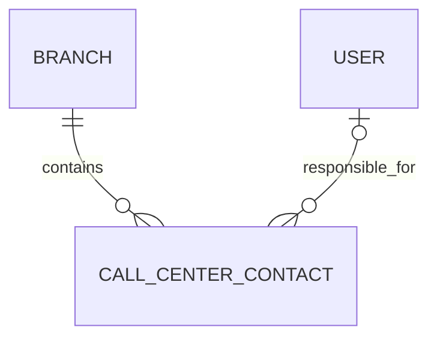

# Call Center manual access — PC-B — 2026-10-21

## Authority and scope

Owner delegates this bounded System/IAM change from PC-A to PC-B. Base: develop
22e42887. Published PC-C Call Center/Issabel/report reservations were released;
PR1012 and PR1014 are merged. Reserve only the manual access catalogue, suggested
Sales roles, Call Center authorization, bounded public IAM/Tasks ports, contact
owner metadata and related tests. No dependency, operational database, existing
role/account mutation, PBX action, runtime restart or automatic merge.

The user confirms: an authorized team is the manager's **own current HR unit**,
intersected with authorized active branches. Another unit in the same branch is
not a team grant. Missing/deleted/inactive units do not expand scope. IAM owns
account membership; HR's existing public unit port validates active units.

The project's Customer Affairs planning baseline is already recorded in
[CUSTOMER-AFFAIRS-BACKEND-ROUTING](CUSTOMER-AFFAIRS-BACKEND-ROUTING.md).
Its 10:1 read/write, 50QPS one-year peak and provisional recovery/latency goals are
planning assumptions, **not measured traffic or production promises**. This task
retains the existing modular monolith, branch tenancy, PII encryption, synchronous
domain transactions and trusted telephony pipeline; no capacity architecture is
selected from invented metrics.

## Compatibility and enforcement

- Existing GET/PATCH `/iam/users/:id/manual-access`, selection shape, revision,
  delegation ceiling, exclusive per-user role, transaction and audit remain.
- Manual section `call-center` precedes generic Customer Affairs classification.
  The route existed but had no dedicated screen in the source catalogue: add one
  unique `customer-affairs.call-center` screen; do not duplicate the route or move
  unrelated support controls.
- Existing effective native legacy grants retain their behavior. No account is
  automatically converted, assigned a new role or assigned a historical contact.
  The manual snapshot represents effective legacy Call Center screen access, so
  saving an unrelated edit does not silently revoke it.
- New granular grants or an explicit change to the Call Center screen opt the
  edited user into `customer_affairs.call_center.scope.v1`. This internal restrictive
  flag is sticky and hidden from operation checkboxes. Removing own/team ticks
  cannot restore legacy branch-wide access. Its addition grants no operation;
  all actual new operation and screen changes retain the delegation ceiling.
- New Sales expert/manager recommendations explicitly include the scope flag.
  Display title changes never produce server authority. No Issabel settings,
  generic Customer Affairs ticket permissions or unrelated support screens are
  added to either recommendation.
- New raw native roles and new manual-user profiles receive restrictive scope
  automatically. A scoped delegator cannot mint/assign a legacy unscoped Call
  Center role using only the shared old native codes. Existing personal-role
  edits retain effective legacy screen access unless Call Center grants/screens
  are explicitly changed; the restrictive flag cannot be removed from an opted-in role.
- Granular permission registration is additive. Seed explicitly excludes new
  opt-in Call Center permissions from automatic administrator-role grants.

The server applies branch + current operator + purpose-specific permission +
owner/current-team predicates to contacts, search, history, notes, manual call
creation/replay, requests, recipients, queues and follow-ups. Reports count the
authorized registrar/claimed-call operators; out-of-contact-scope identities are
excluded from the named top-follow-up projection. Request/task statistics are
scoped separately rather than leaking branch-wide aggregates.

## Responsibility and telephony

Nullable contact owner is a real User FK with RESTRICT deletion, a nonnegative
CAS version, branch/owner list index and independent owner FK lookup index.
Existing contacts remain unassigned. New manually registered scoped contacts get
their authenticated creator as initial owner, with assignment audit in the same
transaction; supplied operator display text is never an authority.

Existing Customer Affairs audit stores assignment/change history. New bounded API:

| Method | Path suffix under `/customer-affairs/call-center/contacts/:id` | Rule |
| --- | --- | --- |
| GET | `/owner` | Scoped contact or explicit unassigned-assignment authority; minimal state/options |
| PATCH | `/owner` | Assign unowned/change owned grant, active own-unit target, branch, CAS, atomic audit |
| GET | `/owner-history` | Independent history grant and scoped contact; bounded response |

These APIs do not reinterpret request execution ownership as permanent contact
ownership. They do not change the existing approved Call Center layout or add an
unapproved owner editor/technical panel. The requested manual-access choices are
operational server permissions, not simulated UI toggles.

Trusted persisted telephony offers authorize only the offered call for their
recipient. They do not bypass contact-history scope. Claim/save use existing
lease/version guards. Scoped Sales experts cannot manually route a call to other
operators; team routing requires its native team permission and scoped recipient.
Outbound checks the live native own-extension grant, active branch/account,
current mapping/team, exactly one own active extension, destination policy and
existing durable dispatch revalidation. Neither role recommendation grants
connection administration. No real PBX call was placed during validation.

## Migration and rollout

Three additive migrations: owner FK/CAS metadata, permission registration only,
and owner FK lookup index. No historical ownership or role grant backfill.
Apply with a backup and **IAM access editing paused during rollout**: all API
instances must run the scoped implementation before admins can assign any new
granular grants. Older API binaries do not understand these new scope grants.
Do not expose an updated editor against mixed old/new API instances.

Rollback is a binary/rollout decision, not an automatic destructive down script:
retain nullable metadata, indexes and audits. Before returning to an old API,
disable newly scoped accounts or restore reviewed access snapshots; do not let an
old API interpret scoped roles as legacy broad read. Any physical column/index
removal after rollback requires explicit approval and export of new owner/audit
data. No operational rollout or rollback is performed in this task.

## Validation evidence

- Contracts: 191 tests; Web IAM/Call Center: 119 tests; permission-seed opt-in regression: 1.
- Call Center/Workflow/Read/Telephony/Issabel PostgreSQL suite: 63 passed,
  including 16 scoped-access checks covering
  actual HTTP validation, own/team/foreign-branch denial, real request/follow-up
  save/replay/CAS, permanent-owner races/history, trusted-offer isolation and live
  outbound grant revocation.
- Manual IAM PostgreSQL + policy: 21 passed, including no changes to another
  existing user, sticky opt-in, revision conflicts, delegation denial and audit.
- Ordinary IAM suite: 206 passed, 5 explicit PostgreSQL/optional skips. The manual
  IAM PostgreSQL cases above were run separately against a freshly migrated DB.
- API/Web typechecks and production builds pass at their recorded checkpoints;
  final changed-source lint/types checks and final publication evidence follow.
- All 183 migrations applied successfully to two **new isolated test databases**
  in the task's dedicated PostgreSQL container. No operational seed or migration.
- An initial Windows Vitest fork/read failure was rerun with one thread. A later
  multi-step new PG test hit the default 5-second test deadline during concurrent
  compilation/migration; standalone rerun passed all 16 without relaxing gates.
- A later concurrent final typecheck hit Windows/native memory exhaustion. Prior
  full API/Web typechecks and production builds passed; stop only task-owned
  compiler processes and the task's disposable PostgreSQL container, then retry
  checks sequentially with bounded heap. Do not stop or alter operational services.
- Seventeen task-specific English access/error translations are included, with
  the existing offline API/editor synchronization script; no unrelated copy edits.
- Database-designer structural projection analysis found no normalization/type/
  constraint issues. Its simplified analyzer ignored JSON index metadata and
  cannot parse ALTER-only SQL; actual index/FK/CHECK presence is verified on
  PostgreSQL. Index optimizer recognized four indexes but suggested an existing
  composite and an unmeasured covering variant; neither duplicate/speculative
  index was added. Generator/validate mode failed with `Column is not JSON
  serializable`; its output was not trusted. Hand-authored DDL was rehearsed on
  PostgreSQL instead. No load-test or measured QPS claim.

## Publication handoff

Integrate released develop e5c7a42d without editing peer Sales source; preserve its
three child-age translations alongside all 17 Call Center keys and regenerate
the conflicted offline catalogues. PC-C readiness snapshot 5d3ebb3f is frozen and
source locks explicitly released; it is not merged here. Its future media paths
must use the exported domain scope port in integration review; retain its separate
recordings.read permission when unioning shared catalogues.

Final ordinary IAM suite: 206 pass, 5 optional skips; Contracts191, Web119,
Call Center PostgreSQL63, isolated IAM PostgreSQL/policy21, seed1 and English
coverage3 pass. Later compiler retries hit Windows native memory and a bounded
1536MiB heap limit, without TypeScript diagnostics; earlier complete API/Web
types/build checkpoints passed. Do not report those final retries as passed.
Draft PR/exact-head hosted quality/test/type/build/database gates and review are
required before readiness/merge. Source/schema/translation locks freeze and
release at candidate publication. No merge/deployment is authorized here.
