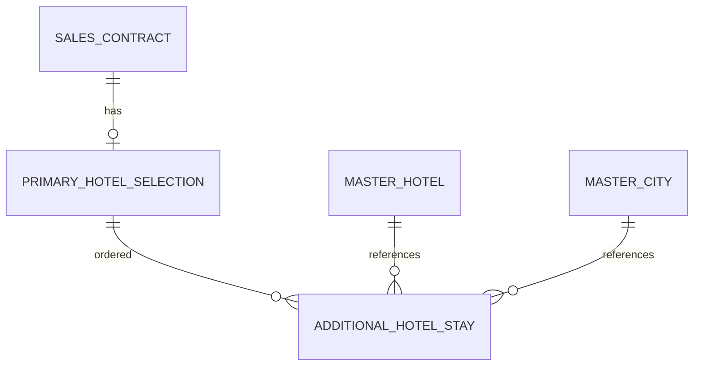

# Composite hotel cities and contract stays — PC-B

Owner requests blank title, repeatable city/hotel rows and inline native Hotel
creation; removes old reference-saleability through backup controls and asks for
Sales loading. Clarified that check-in/out are entered separately in the contract.
Push/develop merge authorized; no production deployment requested.

## Boundaries

- Existing composite member Hotel FKs and priorities retain order, across cities.
  Parent city is the first actual member's compatibility anchor.
- Dedicated create/edit/view form contains title plus city-scoped hotel rows.
  Inline creation reuses native hotel form, API, fields, logo pipeline and rights;
  original row/city identity is checked before selecting the created hotel.
- Sales-only reference projection exposes bounded member identities/names/cities,
  never administrative fields, without granting Master Data administration.
- Contract primary hotel/rooms and totals remain canonical; additional itinerary
  hotels/dates persist in normalized child rows and accompany output/snapshots.
  This does not invent hotel purchases, room products, dates or new charges.
  Published Tour quotes cannot authorize an altered composite itinerary.
- APIs preserve unchanged historic snapshots and omitted itinerary fields during
  compatible updates. Explicit[] clears; changing primary from an old client
  without reviewing the existing itinerary is rejected. Existing CAS/branch/audit
  and financial hooks remain unchanged.

## Storage and verification

Migration20261026120000 adds only sales_contract_hotel_stays. The actual SQL
is verified on disposable PostgreSQL18: UUID references, unique order, date/order
checks, restricted Hotel deletion and parent cascade, all inside rolled-back
isolated schemas. Existing CI hotel-rate-broker test gate runs the regression.
No operational database/production data were used.

Database-designer analyzer and index optimizer ran against the scoped schema and
actual Prisma parent/order query. The name snapshot is intentional historical
denormalization, not an editable duplicate of MasterHotel.name. FK index prefixes
exist in SQL/Prisma; the analyzer's JSON reader omits index metadata and its
suggested duplicate covering index is not applied. Migration generator and its
validate-only mode both fail on their own Table JSON serialization bug; explicit
SQL, Prisma validation and real PostgreSQL assertions are authoritative fallback.

No new platform architecture or load guarantee: existing internal25-staff model,
branch permission gates, transactions and indexed bounded child reads are reused.
Retain child storage on application rollback; do not let old writers modify
multistay contracts after they have been created.

Local evidence: Web639 broad regressions (one unrelated optional skip),54 focused
follow-up assertions including English coverage/output, API85 focused assertions
(including corrected repository stub), affected lint, Contracts/Database builds,
Web production build/types and Prisma validation pass. All193 migrations apply to
empty isolated PostgreSQL18; both hotel/broker and new stay constraint cases pass.
Final API build also passes. Hosted exact-head gates and merge evidence remain pending.
