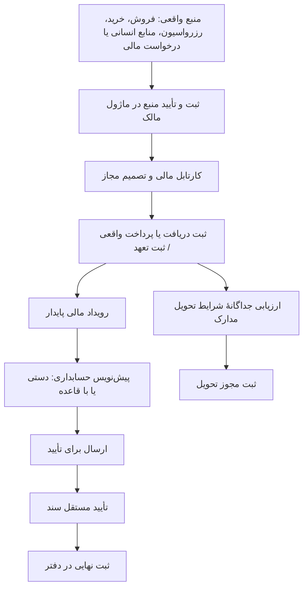

# گزارش مسیر مراودات پولی و تأییدهای مالی سامانه نورا

- تاریخ بررسی اولیه: ۲۰۲۶/۱۰/۲۵؛ به‌روزرسانی: ۲۰۲۶/۱۰/۲۶
- مبنای بررسی: شاخهٔ `develop`، نسخهٔ `b1a0d89492603465fcab51405fff3ec908b2fc14`.
- روش: خواندن مسیرهای صفحه، Controllerهای ثبت‌شده، سرویس‌ها، وضعیت‌ها، قواعد مجوز و اسناد دامنه؛ بدون ایجاد تراکنش یا خواندن اطلاعات واقعی مشتریان و حساب‌ها.
- این گزارش وضعیت **پیاده‌سازی در کد این نسخه** را شرح می‌دهد؛ فعال‌بودن تنظیمات، دسترسی افراد، موجودی بانک و استقرار همین نسخه روی سرور جداگانه بررسی نشده است.
- در این گزارش «مسیر پیاده‌سازی‌شده» یعنی مسیر ثبت‌شدهٔ API و مصرف‌کننده یا منبع واقعی آن وجود دارد؛ وجود یک عنوان منو، کلاس دامنه یا سند نیازمندی به‌تنهایی ملاک عملیاتی‌بودن نیست.
- همهٔ مسیرهای API جدول‌ها با پیشوند مشترک `/api/v1` استفاده می‌شوند.

## یادداشت به‌روزرسانی

این نسخه تمام بخش‌ها، ۲۵ فرایند و منابع گزارش اولیه را حفظ می‌کند و اصلاح‌های انجام‌شده با فرم‌های موجود را توضیح می‌دهد. طبق انتخاب صریح مالک محصول، هیچ دکمه یا فیلد جدیدی اضافه نشده و اتصال بانکی خودکار ایجاد نشده است. اصلاح‌ها در کد و پایگاه دادهٔ آزمایشی بررسی شده‌اند؛ این گزارش به‌تنهایی تأیید استقرار آن‌ها روی ۳۱۰۰ یا سرور نیست.

سه اصلاح این نوبت عبارت‌اند از رفع ناسازگاری تنخواه ارزی، الزام تأیید درخواست مالی توسط شخصی غیر از درخواست‌کننده، و الزام شمارهٔ مرجع برای همهٔ درخواست‌های جدید چک. تغییر پیشین ثبت تعهد قرارداد پس از تأیید دریافت در کارتابل مالی نیز در F01 منعکس شده است. مواردی که ورودی یا فرمان لازم را در فرم‌های فعلی ندارند در بخش ۱۳ با صراحت باقی‌مانده اعلام شده‌اند.

مبنای به‌روزرسانی کد، develop به شناسهٔ be3f21838fd92ed1f5b8c82df2f07457d46423ef و تغییرات شاخهٔ codex/pc-a-financial-internal-gaps-1026 است. منابع S1 تا S25 همچنان نسخهٔ اولیه را نشان می‌دهند؛ برای اصلاح‌های جدید به S26 تا S29 رجوع شود.

## ۱. نتیجهٔ اصلی: چهار تأیید متفاوت وجود دارد

| تأیید                          | سؤال اصلی                                                        | اثر واقعی در سامانه                                          |
| ------------------------------ | ---------------------------------------------------------------- | ------------------------------------------------------------ |
| تأیید تجاری/منبع               | آیا قرارداد، قیمت خرید، فاکتور یا ورودی حقوق معتبر است؟          | مجازشدن ادامهٔ فرایند در ماژول مبدأ                          |
| تأیید مالی و ثبت دریافت/پرداخت | آیا وصول یا پرداخت واقعی با حساب، طرف، مبلغ، ارز و مدرک ثبت شود؟ | تغییر مانده و سابقهٔ مالی؛ تولید رویداد مالی در مسیرهای متصل |
| تأیید و ثبت نهایی سند حسابداری | آیا سند متوازن، دارای مبنا و مورد تأیید مستقل است؟               | رسیدن سند به `POSTED` و ورود به دفتر حسابداری                |
| مجوز تحویل مدارک               | آیا فروش/مشتری اجازهٔ دریافت مدارک سفر دارد؟                     | بازشدن دسترسی مدارک؛ خودش انتقال وجه نیست                    |

**این چهار مرحله معادل یکدیگر نیستند.** تأیید یک درخواست، لزوماً پرداخت نیست؛ ثبت پرداخت، لزوماً سند حسابداری نهایی نیست؛ نهایی‌شدن سند نیز به‌خودی‌خود مجوز تحویل مدارک نمی‌دهد. [S1، S2، S3، S4]



نمودار بالا مسیر مشترک است؛ استثناهای هر منبع در ادامه آمده‌اند. همهٔ منابع یک زنجیرهٔ تأیید یکسان ندارند.

## ۲. از چه صفحه‌هایی وارد می‌شویم؟

| صفحه/ماژول                     | نشانی                                                   | کاربرد در این گزارش                                                                   |
| ------------------------------ | ------------------------------------------------------- | ------------------------------------------------------------------------------------- |
| قرارداد و فروش                 | `/sales`                                                | قرارداد، برنامهٔ دریافت، ثبت پرداخت مشتری، اصلاح و ابطال                              |
| رزرواسیون                      | `/reservations`                                         | ثبت خرید خدمات قرارداد، فرم کارگزار، مدارک سفر و مجوزهای مرتبط                        |
| خرید و تأمین                   | `/ticket-purchases`                                     | کارتابل خرید سفر؛ این صفحه به `ReservationPurchaseWorkspace` متصل است                 |
| صفحه‌ای با عنوان فعلی «تنخواه» | `/purchases`                                            | به `ProcurementWorkspace` متصل است: درخواست، استعلام، سفارش، رسید و فاکتور خرید عمومی |
| کارتابل درخواست‌های مالی       | `/finance/requests`                                     | دریافت‌های فروش، پرداخت خریدها، حقوق، درخواست‌های عملیاتی و ارجاع‌های HR              |
| حسابداری                       | `/finance` و `/finance/accounting/...`                  | دفترها، اسناد، نرخ‌های مصوب، رویدادها و تکمیل فرایندها                                |
| رویدادهای مالی و ثبت حسابداری  | `/finance/accounting/receipts-payments/reports`         | رویدادهای واقعی، ساخت سند و بخش «تکمیل فرایندهای مالی»                                |
| ثبت سند حسابداری               | `/finance/accounting/general-ledger/documents/journals` | ساخت/ویرایش سند؛ فهرست و بازکردن سند لینک‌های دیگری هم دارد                           |
| قطعی‌کردن اسناد                | `/finance/accounting/general-ledger/documents/posting`  | مرحلهٔ ثبت نهایی                                                                      |
| تحویل مدارک                    | `/finance/delivery`                                     | بررسی مجوز تحویل مشتری                                                                |
| منابع انسانی                   | `/human-resources`                                      | ورودی حقوق و درخواست‌های بین‌بخشی                                                     |
| پروندهٔ آژانس/طرف همکاری       | `/organizations`                                        | اعتبار، توافق‌نامه و نمایش/ارسال درخواست‌های مالی طرف همکاری                          |

**دو معنای «تنخواه» را قاطی نکنیم:** صفحهٔ `/purchases` با این عنوان، گردش خرید عمومی را اجرا می‌کند؛ تنخواهِ دارای وجه‌گردان، شارژ، هزینه و استرداد، انواع مستقلی از درخواست‌های عملیاتی مالی است که از کارتابل مالی مدیریت می‌شود. نام منو به‌تنهایی ماهیت جریان را تعیین نمی‌کند. [S5، S6، S7]

نمایش هر صفحه و امکان هر فرمان تابع مجوز و شعبهٔ کاربر است؛ عنوان شغلی به‌تنهایی تضمین دسترسی نیست.

### فهرست سریع جریان‌ها

| شناسه | فرایند                            | نقطهٔ شروع                     | ماهیت نتیجه                                   |
| ----- | --------------------------------- | ------------------------------ | --------------------------------------------- |
| F01   | دریافت وجه قرارداد                | فروش                           | وصول تأییدشدهٔ مشتری                          |
| F02   | پیش‌پرداخت و اقساط                | برنامهٔ پرداخت فروش            | ورود به همان مسیر تأیید دریافت                |
| F03   | تخصیص و برگشت تخصیص دریافت        | دریافت تأییدشده                | جابه‌جایی مانده، بدون بانک تازه               |
| F04   | استرداد مشتری                     | دریافت واقعی قبلی              | ثبت خروج وجه و تغییر مانده                    |
| F05   | خرید بلیت و ظرفیت شرکت            | خرید و تأمین سفر               | ثبت قیمت و پرداخت تأمین‌کننده                 |
| F06   | خرید هتل و ترانسفر                | رزرواسیون                      | پرداخت کارگزار و کنترل ماندهٔ خرید            |
| F07   | خرید بلیت مشتری و سایر خدمات      | خدمت قرارداد در رزرواسیون      | پرداخت خرید؛ بلیت شرط تسویهٔ مشتری دارد       |
| F08   | خرید عمومی                        | درخواست خرید                   | تأیید خرید، تطبیق فاکتور، تأیید مالی و پرداخت |
| F09   | مرجوعی و اصلاح خرید               | Procurement                    | تصمیم اصلاح مالی؛ نه وصول خودکار وجه          |
| F10   | حقوق خالص                         | منابع انسانی                   | تأیید مالی و پرداخت حقوق                      |
| F11   | وام، مساعده و مأموریت HR          | پرونده/ارجاع HR                | پاسخ مالی؛ پل خودکار پرداخت عمومی نیست        |
| F12   | پورسانت و کمیسیون                 | درخواست مالی یا پروندهٔ همکاری | تأیید تعهد و پرداخت                           |
| F13   | درخواست پرداخت چک                 | درخواست مالی                   | پرداخت مستند چک؛ نه کل چرخهٔ وصول             |
| F14   | پرداخت اصلاحی                     | درخواست مالی                   | پرداخت و سابقهٔ اصلاحی                        |
| F15   | درخواست طرف همکاری                | پروندهٔ سازمان/کارگزار         | ورود به همان مسیر مالی موجود                  |
| F16   | تنخواه، شارژ، هزینه، برگشت و بستن | درخواست مالی                   | وجه‌گردان و کنترل مستقل هزینه/مانده           |
| F17   | نتیجهٔ خرید ناموفق                | پرداخت قبلی دارای سند نهایی    | استعلام/نتیجه و تعیین تکلیف تعهد              |
| F18   | استرداد از تأمین‌کننده            | شکست قطعی خرید                 | وصول واقعی وجه برگشتی                         |
| F19   | زیان قطعی خرید                    | شکست قطعی خرید                 | ثبت هزینه، بدون بانک تازه                     |
| F20   | درآمد و کارمزد شرکت               | قرارداد و ایفای تعهد           | شناسایی حسابداری درآمد                        |
| F21   | حقوق ناخالص و کسورات              | درخواست خالص و فیش واقعی       | تعهد حسابداری بدون پرداخت دوباره              |
| F22   | نرخ خرید و تسویهٔ ارزی            | خرید/پرداخت ارزی               | تثبیت مبنا و سند اختلاف تسویه                 |
| F23   | تسعیر، سند دستی و پایان دوره      | حسابداری                       | تأیید مستقل، ثبت یا برگشت سند                 |
| F24   | تحویل مدارک به فروش               | رزرواسیون و خریدهای لازم       | مجوز دسترسی، بدون انتقال پول                  |
| F25   | تحویل مدارک مشتری و استثنا        | مالی یا رزرواسیون مجاز         | مجوز نسخه‌دار طبق مبنای انتخابی               |

## ۳. وضعیت‌های مشترک و نقش افراد

### ۳.۱ درخواست‌های عملیاتی مالی

مسیر معمول حقوق، کمیسیون، درخواست چک، پرداخت اصلاحی و پرداخت‌های تنخواه:

```text
NEW → REVIEW → UNDER_REVIEW → APPROVE → APPROVED
APPROVED → PAY → PAYING → ... → PAID
NEW / UNDER_REVIEW → CORRECTION_REQUIRED → RESUBMIT → NEW
NEW / UNDER_REVIEW → REJECT → REJECTED
```

- شروع بررسی و تأیید: `finance.read` + `finance.request.manage`.
- پرداخت: `finance.read` + `finance.payment.create`.
- بازارسال: فقط درخواست‌کنندهٔ همان درخواست.
- پرداخت جزئی: مانده کم می‌شود؛ پرداخت نهایی وضعیت را `PAID` می‌کند.
- استثنا: تأیید هزینهٔ تنخواه مستقیماً آن را `PAID` می‌کند؛ پرداخت بانکی دوباره ندارد.
- `CLOSE` در این سرویس فقط برای تنخواه اصلی است، نه راه عمومی بستن هر درخواست. [S2]

### ۳.۲ سند حسابداری

```text
DRAFT → submit → PENDING_APPROVAL → approve → APPROVED → post → POSTED
```

- ایجاد/ارسال: `finance.journal.create`.
- تأیید: `finance.journal.approve`؛ تأییدکننده نمی‌تواند سازندهٔ همان سند باشد.
- ثبت نهایی: `finance.journal.post`؛ وجود تأیید مستقل و نسخهٔ معتبر سیاست تأیید لازم است.
- دقیقاً یک سیاست فعال باید مبلغ و ارز پایهٔ سند را پوشش دهد؛ صفر یا چند سیاست منطبق مانع ادامه است.
- سند یادداشتی `MEMORANDUM` با سند متوازن آمادهٔ تأیید یکی نیست.
- سند ثبت‌شده بازنویسی نمی‌شود؛ اصلاح آن از مسیر برگشت/سند اصلاحی و مجوز مربوط انجام می‌شود. [S3]

**تفکیک وظایف به‌روزشده:** تأیید همهٔ درخواست‌های عملیاتی مالی باید توسط شخصی غیر از درخواست‌کننده انجام شود؛ این کنترل قبلاً فقط برای تنخواه برقرار بود و اکنون حقوق، کمیسیون، استرداد، چک و پرداخت اصلاحی را نیز دربرمی‌گیرد. این قاعده، کنترل داخلی استنتاج‌شده برای کاهش تعارض منافع است، نه ادعای الزام قانونی. الزام سه شخص جداگانه برای درخواست، تأیید و پرداخت ایجاد نشده و تأییدهای گذشته تغییر نمی‌کنند. سیاست چندمرحله‌ای خرید عمومی و تأیید مستقل سند حسابداری همچنان مسیر خود را دارند. [S26]

## ۴. جریان‌های ورودی وجه، خروج وجه و جابه‌جایی مانده

### F01 ـ دریافت وجه مشتری بابت قرارداد

**مسیر:** قرارداد فروش → ثبت دریافت/رسید و مدرک → کارتابل مالی → بررسی دریافت → انتخاب حساب مقصد → تأیید مالی → اصلاح ماندهٔ قرارداد → رویداد حسابداری.

1. فروش دریافت را در قرارداد ثبت می‌کند؛ ثبت‌کنندهٔ فروش جای تأییدکنندهٔ مالی نیست.
2. دریافت در حالت `PENDING_FINANCE_CONFIRMATION` وارد صف مالی می‌شود.
3. مالی با `finance.receipt.approve` یکی از تصمیم‌های `APPROVE` یا `CORRECTION_REQUIRED` را ثبت می‌کند.
4. تأیید به حساب مقصد فعال، هم‌ارز و متعلق به شعبه نیاز دارد.
5. تأیید موفق، دریافت را `FINANCE_CONFIRMED` می‌کند و رویداد `CUSTOMER_RECEIPT` می‌سازد.
6. پس از آن اصلاح مستقیم همان دریافت مجاز نیست؛ بازگرداندن پول مسیر استرداد دارد.
7. ثبت سند این رویداد همچنان باید مسیر مستقل حسابداری را طی کند.
8. به‌روزرسانی پس از نسخهٔ اولیه: تأیید واقعی دریافت در کارتابل مالی، برای قرارداد واجد شرایط، رویداد تعهد قرارداد `SALES_CONTRACT_CONFIRMED` را هم در همان تراکنش ایجاد می‌کند. تأیید فروش به‌تنهایی کافی نیست. تعهد بر مبنای کل مبلغ تجاری قرارداد و به تفکیک ارز است؛ دریافت جزئی فقط به اندازهٔ وصول واقعی ثبت می‌شود. تأیید چند رسید یا تکرار همان عملیات، تعهد یکسان را دوباره ایجاد نمی‌کند. نگاشت معتبر می‌تواند پیش‌نویس بسازد؛ قطعی‌سازی مستقل باقی می‌ماند. [S29]

**API:** `POST sales/contracts/:id/payments` → `POST finance/inbox/sales/:paymentId/decision`. [S1، S8]

### F02 ـ پیش‌پرداخت، قسط و دریافت سررسیددار

این‌ها مسیر مالی تازه‌ای خارج از F01 نیستند؛ اجزای برنامهٔ دریافت قراردادند.

**مسیر:** فروش/برنامهٔ پرداخت → دریافت زمان‌بندی‌شده `SCHEDULED` → رسیدن سررسید → بررسی مالی F01 → تأیید وصول واقعی.

- سرویس مالی دریافت `SCHEDULED` را فقط پس از رسیدن موعد می‌تواند تأیید کند.
- ثبت وعدهٔ پرداخت یا شمارهٔ چک معادل وصول نیست.
- برای ورود به ماندهٔ وصول‌شده، تأیید مالی دریافت لازم است.
- تأیید دریافت می‌تواند درخواست جداگانهٔ مجوز تحویل مدارک را نیز همراه داشته باشد؛ مجوز تحویل همچنان قواعد خودش را دارد. [S1، S8]

### F03 ـ تخصیص دریافت تأییدشده به قرارداد دیگر و برگشت تخصیص

**ماهیت:** انتقال مانده/اعتبار دریافتی است؛ دریافت تازه از بانک نیست.

**مسیر:** دریافت تأییدشده و مبنای حسابداری آن → انتخاب قرارداد مجاز مقصد → تعیین مبلغ و علت → کنترل ماندهٔ قابل‌تخصیص و استردادهای رزروشده → ثبت تخصیص → اثر در تسویهٔ قراردادها → پیش‌نویس حسابداری مرتبط → تأیید و ثبت نهایی.

- نیازمند `finance.receipt.approve` و `finance.journal.create`، علاوه بر خواندن مالی است.
- نسخهٔ قراردادهای مبدأ و مقصد و شناسهٔ یکتای عملیات کنترل می‌شود.
- تخصیص فقط بین قراردادهای همان مشتری و همان شعبه انجام می‌شود؛ مبلغ از ماندهٔ هم‌ارز قرارداد مقصد بیشتر نمی‌شود و دریافت تازه یا تبدیل ارز نیست.
- رویدادهای `RECEIPT_ALLOCATION` و `RECEIPT_ALLOCATION_REVERSAL` به دریافت اصلی متصل‌اند و بانک دوم ایجاد نمی‌کنند.
- برگشت تخصیص، فرمان مستقل با علت و سابقه دارد؛ حذف خام تخصیص نیست.

**API:** `POST finance/receipt-allocations/:eventId` و `POST finance/receipt-allocations/:eventId/:allocationId/reverse`. [S9]

### F04 ـ استرداد وجه مشتری، از جمله پس از ابطال یا اصلاح قرارداد

**مسیر:** دریافت واقعی تأییدشده → درخواست `REFUND` متصل به همان دریافت → بررسی مالی → تأیید → ثبت پرداخت واقعی استرداد → کاهش خالص دریافتی مشتری → محاسبهٔ مجدد مانده/مجوز تحویل → حسابداری.

- استرداد بدون `refundReceiptId` مجاز نیست؛ دریافت مبنا باید تأییدشده، هم‌ارز و در همان شعبه باشد.
- سقف قابل‌استرداد با احتساب تخصیص‌ها و درخواست‌های استرداد رزروشده کنترل می‌شود.
- درخواست از مسیر مشترک `NEW → UNDER_REVIEW → APPROVED → PAYING/PAID` می‌گذرد.
- در `PAY`، سرویس عمومی فروش نیز استرداد را اعمال می‌کند؛ رویداد `REFUND_PAYMENT` ثبت می‌شود.
- ابطال قرارداد به‌تنهایی پول مشتری را به بانک برنمی‌گرداند.
- تغییر مانده یا ابطال می‌تواند مجوز تحویل قبلی را خودکار لغو کند؛ ماندهٔ جدید خودکار مجوز جدید نمی‌دهد.

**API:** `POST finance/requests` با `kind=REFUND` → `POST finance/requests/:id/action`. [S2، S9، S10]

### F05 ـ خرید بلیت و ظرفیت شرکت؛ ثبت قیمت خرید و پرداخت تأمین‌کننده

**مسیر:** تعریف/انتشار بلیت و ایجاد منبع خرید → کارتابل خرید و تأمین → تعیین تأمین‌کننده و قیمت خرید نسخه‌دار → کارتابل مالی → پرداخت جزئی/کامل → به‌روزرسانی وضعیت خرید → حسابداری.

- مسئول ثبت قیمت خرید `procurement.quote.manage` دارد؛ ثبت قیمت خرید از فرم قدیمی مالی عمداً ممنوع شده است.
- ثبت هزینه با تعداد صندلی، مبلغ کل یا قیمت واحد و نسخهٔ هزینه مرتبط است؛ خرید گروهی نیز فرمان مستقل `group-costs` دارد.
- مالی با `finance.payment.create`، نسخهٔ دقیق قیمت خرید، مبلغ، مبدأ پرداخت، روش، مرجع و زمان را ثبت می‌کند.
- وضعیت پرداخت می‌تواند `PARTIALLY_PAID` یا `PAID` باشد؛ تسویهٔ کامل به Procurement بازتاب می‌یابد.
- **زمان رویداد تعهد مهم است:** برای منابع جدیدِ مشمول اتصال حسابداری، `TICKET_PAYABLE` در اولین پرداخت این مسیر ساخته می‌شود؛ صرف ثبت قیمت خرید را نباید سند نهایی بدهی فرض کرد. `TICKET_PAYMENT` برای پرداخت واقعی ثبت می‌شود.
- قیمت قطعی قابل‌مصرف در مرزهای بعدی با وضعیت پرداخت و نسخهٔ واقعی منبع کنترل می‌شود.

**API:** `POST procurement/ticket-purchases/:requestId/costs` یا `.../group-costs` → `POST finance/ticket-purchases/:requestId/payments`. [S11]

### F06 ـ خرید هتل و ترانسفر قرارداد از کارگزار

**مسیر:** قرارداد فعال → رزرواسیون و فرم کارگزار → ثبت خرید هتل/ترانسفر یا بستهٔ خرید → صف مالی → ثبت پرداخت کارگزار → کنترل تسویهٔ خریدهای لازم → مجوز جداگانهٔ تحویل مدارک.

- ثبت خرید هتل به فرم واقعاً ارسال‌شده و اطلاعات همان نسخه وابسته است؛ هزینهٔ مسافر/شب و جمع خرید در سرور کنترل می‌شود.
- خرید می‌تواند چند خدمت را در یک بسته پوشش دهد؛ نباید هر پوشش را پرداخت مستقل و تکراری حساب کرد.
- مالی پرداخت را تأیید/ثبت یا خرید را رد می‌کند؛ پرداخت جزئی تا تسویهٔ کامل مانده دارد.
- برای منابع جدید، `RESERVATION_PAYABLE` در اولین پرداخت و `RESERVATION_PAYMENT` برای پرداخت ثبت می‌شود.
- تکمیل پرداخت خرید با مجوز تحویل یکی نیست؛ پس از تسویه نیز تصمیم تحویل باید ثبت شود.

**API مبدأ:** `POST reservations/requests/:id/hotel-purchase`، `.../service-purchases` یا `.../purchase-batches`.

**API مالی:** `POST finance/inbox/reservations/:intakeId/purchases/:purchaseId/payments`.

**مسیر جایگزین موجود:** `PATCH reservations/requests/:id/service-purchases/:purchaseId/payment` با `finance.financial_release.approve` همان سرویس پرداخت خرید را صدا می‌زند؛ این تفاوت مجوز با مسیر کارتابل مالی باید در طراحی دسترسی لحاظ شود. [S12، S13]

### F07 ـ خرید بلیت مشتری/شناور و سایر خدمات سفر از رزرواسیون

**مسیر:** خدمت واقعی قرارداد → ثبت خرید برای همان `serviceClientKey` → صف پرداخت رزرواسیون در مالی → پرداخت → رویداد مالی → حسابداری.

- سرویس عمومی خرید رزرواسیون، خدمات واقعی Snapshot را مبنا قرار می‌دهد؛ ایجاد خرید برای خدمت ناموجود مجاز نیست.
- برای خریدی که خدمتش `FLIGHT` است، **تسویهٔ کامل قرارداد مشتری پس از کسر وجوه رزروشدهٔ استرداد** کنترل می‌شود. این قاعده را نباید به همهٔ خریدهای هتل یا خرید ظرفیت عمومی شرکت تعمیم داد.
- این مسیر با خرید ظرفیت عمومی بلیت در F05 یکی نیست.
- ثبت هزینهٔ بیمه، ویزا یا سایر خدمات از مسیر عمومی خرید، اثبات وجود صدور یا استرداد خودکار API شرکت بیمه/Provider نیست.
- ادامهٔ مالی و وضعیت پرداخت مشابه F06 است. [S12، S14]

### F08 ـ خرید عمومی کالا، تجهیزات و خدمات سازمانی

**مسیر کامل:** درخواست خرید → سیاست مصوب و تأییدهای خرید → استعلام‌ها → انتخاب پیشنهاد → سفارش و تأیید لازم → دریافت/پذیرش کالا یا خدمت → فاکتور → تطبیق → ارسال به مالی → تصمیم مالی → پرداخت → حسابداری.

- مسیر خرید در صفحهٔ فعلی `/purchases` اجرا می‌شود، هرچند عنوان فعلی صفحه «تنخواه» است.
- سیاست خرید باید برای شعبه، واحد، دسته و ارز معتبر باشد؛ سقف مبلغ، خرید اضطراری، حداقل استعلام و مسئول هر مرحله کنترل می‌شود.
- مراحل تأیید خرید، مسئول مستقل دارند؛ نبود سیاست معتبر مسیر ارسال را متوقف می‌کند.
- پیش از ارسال مالی، فاکتور باید تطبیق شده و مغایرت باز سفارش رفع شده باشد.
- `SUBMIT_FINANCE` یک Handoff/Outbox نسخه‌دار ایجاد می‌کند و فاکتور را `WAITING_FINANCE` می‌کند.
- مالی با `APPROVE` یا `CORRECTION_REQUIRED` تصمیم می‌گیرد. تأیید، رویداد `SUPPLIER_INVOICE_APPROVED` می‌سازد.
- پرداخت فقط بر مبنای منبع/نسخهٔ معتبر و وضعیت مالی لازم انجام می‌شود؛ پرداخت‌های جزئی و مانده به ماژول خرید بازمی‌گردند.
- پرداخت واقعی رویداد `SUPPLIER_PAYMENT` دارد؛ سند نهایی همچنان مسیر حسابداری را طی می‌کند.

**API:** `POST procurement/requests/:id/commands` → `POST finance/inbox/purchases/invoices/:invoiceId/decision` → `.../:invoiceId/payments`. [S15، S1]

### F09 ـ مرجوعی یا اصلاح خرید عمومی پس از ورود به مالی

**مسیر:** مرجوعی/اصلاح در Procurement → رویداد اصلاح مالی → کارتابل مالی → بررسی نسخه و علت → `APPROVE` یا `CORRECTION_REQUIRED` → بازتاب نتیجه به خرید.

- مرجوعیِ کالای دریافت‌شده با «وصول پول برگشتی از تأمین‌کننده» یکسان نیست.
- فرمان تصمیم اصلاح، نتیجهٔ بررسی را به منبع خرید برمی‌گرداند؛ همین فرمان به‌تنهایی انتقال وجه بانکی یا رویداد پرداخت تازه ایجاد نمی‌کند.
- اگر وصول واقعی وجه مطرح باشد، باید بر مبنای پرداخت واقعی و مسیر مناسب استرداد/حسابداری ثبت شود؛ صرف وضعیت مرجوعی اثبات وصول نیست.

**API:** `POST finance/inbox/purchases/corrections/:eventId/decision`. [S1، S15]

### F10 ـ حقوق خالص کارکنان

**مسیر:** کارمند واقعی HR → ورودی تأییدشدهٔ حقوق کارمند/دوره → انتشار محدود به مالی → درخواست `PAYROLL` → بررسی و تأیید مالی → پرداخت جزئی/کامل → سوابق حقوق و حسابداری.

- ارسال منبع حقوق به مجوزهای `hr.manage`، `hr.approve` و `hr.sensitive` نیاز دارد.
- شناسهٔ کارمند واقعی، مبلغ، ارز صریح، دوره و سررسید لازم است؛ حساب IAM به‌تنهایی کارمند حقوق‌بگیر نیست.
- دورهٔ درخواست این مسیر `YYYY-MM` میلادی است؛ با دورهٔ شمسی فیش نباید بی‌تأیید تطبیق داده شود.
- برای یک کارمند/دوره، درخواست تکراری آزاد ساخته نمی‌شود؛ اصلاح نیز شرایط منبع و مانده دارد.
- تأیید مالی، در صورت پوشش‌ندادن تعهد توسط فرایند ناخالص، `PAYROLL_NET_APPROVED` می‌سازد.
- پرداخت واقعی `PAYROLL_PAYMENT` ایجاد می‌کند.
- مالی فقط تصویر حداقلی موردنیاز را دریافت می‌کند؛ تأیید مالی مجوز دست‌کاری حضور، ارزیابی یا پروندهٔ خصوصی HR نیست.

**API:** `POST hr/payroll-finance` → `POST hr/payroll-finance/:id/action`؛ فرمان مالی مشترک `finance/requests/:id/action` نیز سرویس همین درخواست را دارد. [S2، S16]

### F11 ـ مساعده، وام، هزینهٔ مأموریت، مطالبات و تسویهٔ HR

**مسیر موجود ارجاع:** ثبت منبع HR → ارتباطات بین‌بخشی با مقصد مالی → کارتابل مالی/ارجاع HR → پاسخ مقصد → ثبت نتیجه در سابقهٔ HR.

- **این ارجاع به‌تنهایی پرداخت نمی‌کند و وضعیت پروندهٔ مالی مقصد را تغییر نمی‌دهد.**
- پاسخ‌دهنده باید مجوز دریافت ارجاع مقصد داشته باشد؛ پاسخ به درخواست خود یا مربوط به خود محدود شده است.
- منبع حقوقِ F10 پل مشخص پرداخت دارد؛ برای هر عنوان وام، مساعده و مأموریت نباید به‌صرف وجود فرم HR، پل خودکار پرداخت، جدول اقساط، برداشت اقساط وام و تسویهٔ بانکی فرض کرد.
- در صورت استفاده از درخواست مالی مستقل برای پرداخت مستند، آن درخواست چرخهٔ مالی خودش را طی می‌کند؛ همگام‌سازی خودکار کامل با وام/کسورات HR در این مسیر ارجاع اثبات نشده است.

**API:** `POST hr/connections` → `POST hr/connections/:id/response`. [S17]

### F12 ـ کمیسیون و پورسانت پرداختنی

**مسیر:** ثبت درخواست `COMMISSION` در مالی یا پروندهٔ طرف همکاری → بررسی → تأیید → ثبت پرداخت جزئی/کامل → حسابداری.

- تأیید درخواست، تعهد `COMMISSION_APPROVED` و پرداخت، `COMMISSION_PAYMENT` ایجاد می‌کند.
- کارمزد پرداختنی به آژانس، «درآمد کارمزد شرکت» نیست؛ درآمد مسیر F20 دارد.
- ثبت درصد کمیسیون روی بلیت/قرارداد نیز به‌خودی‌خود پرداخت بانکی پورسانت نیست.
- اتصال واقعی به سازمان/نقش و مدارک، در مسیر پروندهٔ طرف همکاری اعتبارسنجی می‌شود.

**API:** `POST finance/requests` با `kind=COMMISSION` → `POST finance/requests/:id/action`. [S2، S18]

### F13 ـ درخواست پرداخت چک

**مسیر موجود:** درخواست `CHECK` با مرجع چک → بررسی مالی → تأیید → ثبت پرداخت واقعی → `CHECK_PAYMENT` → حسابداری.

- در تمام درخواست‌های جدید چک، چه مرتبط با طرف همکاری و چه مستقل، شماره/مرجع چک در فیلد موجود الزامی است. درخواست بدون مرجع پیش از ثبت رد می‌شود؛ ثبت‌های قبلی بازنویسی نمی‌شوند. این کنترل جایگزین احراز صیاد یا چرخهٔ وصول چک نیست. [S26]
- این نوع درخواست از گردش عادی درخواست مالی عبور می‌کند.
- **این مسیر را نباید با کل چرخهٔ چک دریافتی/پرداختی، ثبت صیاد، واگذاری، وصول و برگشت بانکی یکسان دانست.** وجود وضعیت‌های چک در کد دامنه، به معنی وجود تمام مسیرهای عملیاتی ثبت‌شده برای آن‌ها نیست. [S2، S19]

### F14 ـ پرداخت اصلاحی، تسویه و اختلاف مستند

**مسیر:** درخواست `ADJUSTMENT` با طرف و مرجع واقعی → بررسی → تأیید → ثبت پرداخت → حسابداری.

- تأیید درخواست می‌تواند `ADJUSTMENT_APPROVED` و پرداخت `ADJUSTMENT_PAYMENT` بسازد.
- این مسیر پرداختِ مستند است؛ مجوز تغییر مستقیم سند نهایی، ماندهٔ دلخواه یا پاک‌کردن تراکنش قبلی نیست.
- اصلاح سند قبلی باید جداگانه از مسیر برگشت/سند اصلاحی انجام شود.

**API:** `POST finance/requests` با `kind=ADJUSTMENT` → `.../:id/action`. [S2، S3]

### F15 ـ درخواست مالی از پروندهٔ آژانس، تأمین‌کننده یا کارگزار

**مسیر:** پروندهٔ سازمان/نقش معتبر → ایجاد درخواست کمیسیون، چک یا اختلاف/اصلاح → همان کارتابل مالی F12 تا F14 → پرداخت و سابقه.

- پروندهٔ B2B بانک یا دفتر مستقل ایجاد نمی‌کند؛ درخواست پولی را به Finance می‌فرستد.
- نمایش مانده، خریدها و تسویه‌های طرف همکاری از سرویس‌های عمومی Finance/Procurement/Reservations تغذیه می‌شود؛ ثبت دوبارهٔ همان خرید یا پرداخت نیست.
- تأیید توافق‌نامه و اعتبار B2B با مجوزهای `b2b.agreement.approve` و در صورت وجود اعتبار، `b2b.credit.approve`، با تأیید پرداخت مالی فرق دارد.
- اعتبارِ مصوب B2B را نباید مجوز خودکار تحویل مدارک یا انتقال خودکار پول تلقی کرد.

**API پرداخت:** همان `finance/requests`؛ درخواست به `counterpartyOrganizationId` و نقش معتبر متصل می‌شود. [S18، S2، S4]

### F16 ـ تنخواه واقعی: تأمین اولیه، شارژ، هزینه، برگشت و بستن

| زیرجریان                         | مسیر دقیق                                                                       | اثر/شرط پایان                                                                                   |
| -------------------------------- | ------------------------------------------------------------------------------- | ----------------------------------------------------------------------------------------------- |
| تأمین اولیه `PETTY_CASH_ADVANCE` | درخواست تنخواه اصلی → بررسی → تأیید مستقل از درخواست‌کننده → ثبت پرداخت از حساب | ایجاد وجه در اختیار تنخواه؛ `PETTY_CASH_ADVANCE_PAYMENT`                                        |
| شارژ `PETTY_CASH_TOPUP`          | درخواست متصل به تنخواه اصلی → بررسی → تأیید مستقل → پرداخت                      | وجه جدید؛ ماندهٔ بعد از شارژ نباید از سقف مصوب نگهداری تنخواه بیشتر شود                         |
| هزینه `PETTY_CASH_EXPENSE`       | درخواست هزینه + نسخهٔ مشخص مدرک → بررسی → تأیید مستقل → کنترل مدرک و مانده      | مستقیماً `PAID`؛ `PETTY_CASH_EXPENSE_POSTED`؛ **پرداخت بانکی دوباره ندارد**                     |
| بازگشت `PETTY_CASH_RETURN`       | درخواست متصل به تنخواه → بررسی → تأیید → ثبت وصول واقعی                         | نیاز اضافی به `finance.receipt.approve`؛ مبلغ حداکثر ماندهٔ تنخواه؛ `PETTY_CASH_RETURN_PAYMENT` |
| بستن تنخواه                      | فرمان `CLOSE` روی تنخواه اصلی                                                   | مانده باید صفر و درخواست‌های وابسته تعیین‌تکلیف شده باشند                                       |

- مانده از پرداخت‌های واقعی تأمین/شارژ، هزینه‌های تأییدشده و برگشت‌های ثبت‌شده محاسبه می‌شود.
- مدرک هزینه باید همان نسخهٔ زمان ثبت باشد؛ تغییر نسخه مانع تأیید آن درخواست می‌شود.
- **اصلاح تنخواه ارزی:** تأمین، شارژ و برگشت تنخواه در تمام ارزها از حساب واقعی فعال، هم‌ارز و متعلق به همان شعبه استفاده می‌کنند. تأمین‌کنندهٔ پرداخت‌کننده برای تنخواه پذیرفته نمی‌شود. قاعدهٔ پرداخت ارزی سایر خریدها تغییر نکرده است. چرخهٔ کامل ریالی و دلاری شامل تأمین، هزینه، سقف شارژ، برگشت و بستن با ماندهٔ صفر در پایگاه دادهٔ آزمایشی موفق بود. نرخ مصوب و نگاشت حسابداری برای ساخت سند ارزی همچنان لازم است. [S27، S28]

**API همهٔ زیرجریان‌ها:** `POST finance/requests` با نوع مربوط → `POST finance/requests/:id/action`. [S2، S20، S21]

## ۵. فرایندهای تکمیلی حسابداری که تأیید می‌خواهند

ورودی این بخش: حسابداری → «رویدادهای مالی و ثبت حسابداری» → «تکمیل فرایندهای مالی».

فرمان مشترک:

```text
POST finance/accounting/books/:bookId/actions/workflow-create
POST finance/accounting/books/:bookId/actions/workflow-journal
سپس submit → approve → post روی سند ساخته‌شده
```

ثبت مبنای یک فرایند با ثبت نهایی سند آن یکی نیست. [S22، S3]

### F17 ـ تعیین نتیجهٔ خرید پرداخت‌شده: استعلام، موفقیت یا شکست

**مسیر:** پرداخت واقعی دارای سند نهایی → انتخاب منبع همان پرداخت → ثبت مرجع، تاریخ و علت → `PURCHASE_OUTCOME` با وضعیت `INQUIRY / SUCCESS / FAILED`.

- استعلام و موفقیت، انتقال پول یا سند پولی تازه ایجاد نمی‌کنند.
- شکست قطعی می‌تواند مبنای سند معکوس تعهد خرید همان نسخه شود.
- سند پرداخت اصلی و سابقهٔ بانک حفظ می‌شود.
- تغییر نتیجه پس از مصرف مبلغ در استرداد/زیان یا وجود سند نهایی محدود است. [S22]

### F18 ـ وصول وجه از تأمین‌کننده پس از خرید ناموفق

**مسیر:** پرداخت واقعی → شکست قطعی خرید F17 → مبنای `SUPPLIER_REFUND` → حساب واقعی وصول + مبلغ/تاریخ/مرجع → تأیید مجاز دریافت → ساخت سند → تأیید مستقل و ثبت نهایی.

- علاوه بر مجوز ساخت سند، `finance.receipt.approve` لازم است.
- مجموع وجه برگشتی و زیان قطعی نباید از پرداخت واقعی بیشتر شود.
- برای ارز خارجی، نرخ و مبنای دفتری معتبر کنترل می‌شود؛ نرخ امروز جای نرخ تاریخی نمی‌نشیند.
- این مسیر با استرداد پول مشتری F04 و صرف مرجوعی کالا F09 متفاوت است. [S22]

### F19 ـ زیان قطعیِ بخشی از خرید ناموفق

**مسیر:** پرداخت واقعی → شکست قطعی → مبنای `PURCHASE_WRITE_OFF` با مستند تصمیم → حساب هزینهٔ انتخاب‌شده → سند → تأیید مستقل → ثبت نهایی.

**پول تازه از بانک خارج نمی‌شود.** بخشی از وجه قبلاً پرداخت‌شده که قابل وصول نیست تعیین‌تکلیف می‌شود؛ سقف مشترک با استرداد تأمین‌کننده کنترل می‌شود. [S22]

### F20 ـ شناسایی درآمد شرکت و کارمزد نمایندگی

**مسیر:** قرارداد معتبر و نسخهٔ قیمت واقعی → تأیید مستند ایفای تعهد → انتخاب نقش اصیل/نماینده → `REVENUE` → انتخاب حساب‌های واقعی → سند → تأیید مستقل → ثبت نهایی.

- وصول وجه به‌تنهایی درآمد نیست.
- در نقش اصیل، مبنای درآمد از اجزای واقعی قرارداد و مالیات ثبت‌شدهٔ منبع استخراج می‌شود.
- در نقش نماینده، فقط کارمزد صریح و مستند شرکت درآمد است؛ پورسانت پرداختنی به آژانس، درآمد شرکت فرض نمی‌شود.
- برای قرارداد/ارز، مبنای فعال تکراری مجاز نیست.
- پیش از اصلاح قیمت یا ابطال قرارداد دارای مبنای درآمد، مبنا و سند مربوط باید تعیین‌تکلیف شوند.
- این ثبت نباید پرداخت بانک یا تعهد خرید قبلی را تکرار کند. [S22، S23]

### F21 ـ ثبت حقوق ناخالص و کسورات واقعی

**مسیر:** درخواست حقوق خالص HR + فیش واردشدهٔ همان کارمند/دوره → تأیید انطباق دوره → کنترل ناخالص، کسورات و خالص → `PAYROLL` در تکمیل فرایندها → سند → تأیید مستقل → ثبت نهایی.

- ناخالص منهای کسورات باید دقیقاً با خالص مصوب و ارز منبع منطبق باشد.
- اگر تعهد خالص قبلاً نهایی شده، دوباره ثبت نمی‌شود؛ فقط بخش تکمیلی لازم ثبت می‌شود.
- اگر سند ناخالص از قبل خالص را پوشش داده، تأیید مالی F10 نباید تعهد خالص تکراری بسازد.
- این مسیر محاسبه‌گر خودکار قانونی مالیات، بیمه یا سهم کارفرما نیست؛ ارقام واقعی منبع را ثبت می‌کند.
- پرداخت حقوق همچنان همان F10 است؛ ثبت ناخالص پرداخت بانکی جدید ندارد. [S16، S22، S23]

### F22 ـ سه مسیر متفاوت نرخ ارز

| مسیر                                 | عبور و تأیید                                                                                                   | اثر                                                          |
| ------------------------------------ | -------------------------------------------------------------------------------------------------------------- | ------------------------------------------------------------ |
| نرخ مبنای خرید                       | خرید واقعی → Snapshot نرخ خرید/ثبت نرخ مبنا در مالی                                                            | ثابت‌کردن مبنای مقایسهٔ خرید و پرداخت؛ خودِ آن حرکت پول نیست |
| نرخ حسابداری                         | ذخیرهٔ نرخ `save-fx` → `approve-fx` توسط شخصی غیر از سازنده                                                    | Snapshot مصوب زمان عملیات برای سند ارزی                      |
| اختلاف تسویهٔ پرداخت `FX_SETTLEMENT` | تعهد نهایی خرید + سند نهایی پرداخت + تسعیرهای معتبر → محاسبهٔ سهم دفتری → مبنای اختلاف → سند → تأیید/ثبت نهایی | فقط تعدیل بدهی و سود/زیان تسعیر؛ بانک دوم ندارد              |

- پرداخت جزئی، تسویهٔ تاریخی و باقیماندهٔ گردکردن کنترل می‌شود.
- مبنای نامشخص، چند نسخهٔ مبهم یا ترتیب نامعلوم تسعیر/پرداخت نباید حدس زده شود.
- اختلاف صفر، مبنای قابل‌پیگیری دارد ولی سند صفر ساخته نمی‌شود.
- نرخ خرید اطلاعات پایه یا یک عدد دستیِ پرداخت، الزاماً همان Snapshot مصوب دفتر حسابداری نیست.

**API نرخ خرید:** `POST finance/purchase-fx/:id`.

**API حسابداری:** فرمان‌های `save-fx`، `approve-fx` و فرایند `FX_SETTLEMENT` زیر `finance/accounting/books/:bookId/actions/:action`. [S21، S22، S3]

### F23 ـ تسعیر پایان دوره، سند دستی، انتقال حسابداری و برگشت سند

**مسیر مشترک:** مبنای واقعی/حساب‌ها و دورهٔ باز → پیش‌نمایش → پیش‌نویس → ارسال → تأیید مستقل → ثبت نهایی.

- تسعیر با فرمان‌هایی مانند `revaluation-run` و `document-revaluation-run`، اثر حسابداری ماندهٔ ارزی است؛ پرداخت بانکی نیست.
- انتقال/جابجایی اسناد و تخصیص حسابداری نیز معادل انتقال واقعی وجه بین دو بانک نیست.
- ثبت دستی می‌تواند اثر مستند انتقال حساب‌ها، هزینه یا بدهی را ثبت کند، اما به‌تنهایی وجود یک فرایند مستقل خزانه‌داری برای انتقال پول را ثابت نمی‌کند.
- برگشت سند با `reverse` به `finance.journal.reverse` نیاز دارد؛ سند نهایی اصلی بازنویسی نمی‌شود.
- بستن دوره/پایان سال با `finance.period.close`، نبود فرایند باز یا تعیین‌تکلیف‌نشده و کنترل‌های همان دوره را می‌خواهد.
- مبنای درآمد، حقوق، خرید ناموفق یا تسویهٔ ارزیِ دارای سند نهایی‌نشده می‌تواند مانع بستن دوره شود. [S3، S22]

## ۶. مجوزهای مرتبط با پول، بدون انتقال وجه

### F24 ـ آزادسازی مدارک رزرواسیون برای فروش

**مسیر:** ثبت خریدهای لازم هتل/ترانسفر → پرداخت کامل خریدهای لازم → درخواست/تصمیم مالی تحویل → ثبت نسخهٔ مجوز → دسترسی فروش به مدارک.

- سرویس هنگام تأیید، نبود خرید و آخرین وضعیت پرداخت آن‌ها را دوباره کنترل می‌کند.
- این گیت بر خریدهای لازم هتل و ترانسفر تکیه دارد؛ نباید بدون بررسی به همهٔ خدمات تعمیم داده شود.
- صرف صدور واچر یا تسویهٔ یک ردیف خرید، به‌تنهایی تأیید این گیت نیست.

**API:** `PATCH reservations/requests/:id/delivery` با `finance.financial_release.approve`. [S13]

### F25 ـ مجوز تحویل مدارک مشتری؛ با مسیر استثنای رزرواسیون

**مسیر عادی:** وضعیت واقعی قرارداد/دریافت مشتری → تصمیم مجوز → کنترل مبنا → نسخهٔ مجوز تحویل.

مبناهای موجود:

- `AFTER_RECEIPT`: حداقل یک دریافت مشتری تأییدشده لازم است.
- `FULL_SETTLEMENT`: تسویهٔ کامل قرارداد لازم است.
- `MANAGER_EXCEPTION`: علت، مرجع تأییدکنندهٔ دوم و مدت اعتبار؛ قواعد استثنا نیز ارزیابی می‌شود.
- `RESERVATION_PERMISSION`: **مسیر استثنای صریح رزرواسیون** با `reservations.documents.manage` و علت ۵ تا ۵۰۰ نویسه؛ این مسیر را نمی‌توان «همیشه نیازمند تأیید مالی» توصیف کرد.

**API مالی:** `POST finance/customer-document-delivery/:contractId` با `finance.financial_release.approve`.

**API استثنای رزرواسیون:** `POST finance/reservation-document-delivery/:contractId` با `reservations.documents.manage`.

لغو قرارداد یا تغییر مانده/استرداد می‌تواند مجوز ناسازگار قبلی را لغو کند. موجودی یا تأیید پرداخت جدید به‌تنهایی مجوز تازه نمی‌سازد. دریافت فرم رزرواسیون برای کارگزار نیز همان مجوز تحویل مدارک مشتری نیست. [S4، S10]

## ۷. ضابطهٔ فعلی مبدأ پرداخت ریالی و ارزی

قاعدهٔ پیش‌فرض تابع مشترک `paymentSource` برای پرداخت‌های غیرتنخواه در جدول زیر آمده است. تنخواه در تمام ارزها از سیاست صریح `ACCOUNT_ONLY` و حساب فعال هم‌ارز همان شعبه استفاده می‌کند. [S27]

| ارز        | مبدأ پذیرفته‌شده                                                 | چیزی که نباید فرض شود                                                                           |
| ---------- | ---------------------------------------------------------------- | ----------------------------------------------------------------------------------------------- |
| ریال `IRR` | حساب تسویهٔ فعال همان شعبه و ارز؛ بدون تأمین‌کنندهٔ پرداخت‌کننده | صرف انتخاب نام بانک، حساب معتبر نیست                                                            |
| غیرریالی   | `payingSupplierId` معتبر؛ بدون `accountId`                       | این کد الزاماً خروج ارز از حساب بانکی خود شرکت را ثبت نمی‌کند؛ پرداخت‌کنندهٔ تأمین‌کننده مبناست |

روش پرداخت، مبلغ مثبت و حداکثر مانده، زمان، مرجع، نرخ‌های لازم و نسخهٔ منبع نیز در سرویس مربوط کنترل می‌شوند. این قاعده را نباید به دریافت مشتری یا وصول استرداد تأمین‌کننده، که حساب واقعی مقصد دارند، تعمیم داد. استثنای حساب واقعی برای تنخواه ارزی در F16 اصلاح شده است. [S27] [S21]

## ۸. از رویداد پولی تا حسابداری دقیقاً چه می‌شود؟

1. سرویس مالک، دریافت/پرداخت/تأیید تعهد را در تراکنش خودش ثبت می‌کند.
2. همان تراکنش، رویداد مالی پایدار را با شناسهٔ منبع، مبلغ، ارز، شعبه و مرجع می‌سازد؛ شکست ثبت رویداد نباید تأیید منبع را نیمه‌کاره باقی بگذارد.
3. Dispatcher هر ۳۰ ثانیه رویدادهای بدون سند را بررسی می‌کند.
4. اگر دقیقاً یک قاعدهٔ منطبق و دسترسی معتبر وجود داشته باشد، پیش‌نویس ساخته می‌شود. در غیر این صورت خطا/نیاز به انتخاب و تطبیق ثبت می‌شود و حسابدار باید آن را رفع کند.
5. Dispatcher **هیچ سندی را تأیید یا ثبت نهایی نمی‌کند**.
6. حسابدار می‌تواند رویداد را از صفحهٔ مربوط انتخاب و پیش‌نویس را با حساب‌ها، تفصیلی‌ها، دوره و نرخ مصوب بسازد.
7. سند باید جداگانه ارسال، مستقل تأیید و نهایی شود.

برای تعهدهای قدیمی، زمان فعال‌شدن migration اتصال حسابداری ملاک است؛ نباید فرض کرد تمام تعهدهای تاریخی خودکار بازسازی شده‌اند. مسیر تطبیق منابع تاریخی و `source-journal` نیز وجود دارد. [S24، S3]

### فرهنگ رویدادهای اصلی

رویداد تعهد قرارداد `SALES_CONTRACT_CONFIRMED` نیز پس از تأیید واقعی دریافت مالی و احراز شرایط قرارداد ایجاد می‌شود؛ این رویداد به فهرست نسخهٔ اولیه اضافه شده و مستقل از `CUSTOMER_RECEIPT` است. [S29]

| دسته                    | رویدادها                                                                                                           |
| ----------------------- | ------------------------------------------------------------------------------------------------------------------ |
| دریافت مشتری            | `CUSTOMER_RECEIPT`                                                                                                 |
| انتقال ماندهٔ دریافت    | `RECEIPT_ALLOCATION`، `RECEIPT_ALLOCATION_REVERSAL`                                                                |
| تعهد خرید               | `TICKET_PAYABLE`، `RESERVATION_PAYABLE`، `SUPPLIER_INVOICE_APPROVED`                                               |
| پرداخت خرید             | `TICKET_PAYMENT`، `RESERVATION_PAYMENT`، `SUPPLIER_PAYMENT`                                                        |
| حقوق/پورسانت/اصلاح      | `PAYROLL_NET_APPROVED`، `COMMISSION_APPROVED`، `ADJUSTMENT_APPROVED` و رویدادهای پرداخت متناظر                     |
| پرداخت چک/استرداد مشتری | `CHECK_PAYMENT`، `REFUND_PAYMENT`                                                                                  |
| تنخواه                  | `PETTY_CASH_ADVANCE_PAYMENT`، `PETTY_CASH_TOPUP_PAYMENT`، `PETTY_CASH_EXPENSE_POSTED`، `PETTY_CASH_RETURN_PAYMENT` |

این فهرست از قرارداد عمومی رویدادهای حسابداری استخراج شده است؛ وجود یک رویداد به معنی ارسال خودکار وجه از بانک نیست. [S25]

## ۹. ماتریس کوتاه مجوزها

| عملیات                                 | مجوز شاخص                                                   |
| -------------------------------------- | ----------------------------------------------------------- |
| ثبت پرداخت مشتری در فروش               | `sales.payments.create`؛ سایر کنترل‌های فروش نیز برقرار است |
| تأیید وصول فروش/فاکتور خرید/اصلاح خرید | `finance.receipt.approve`                                   |
| بررسی و تأیید درخواست عملیاتی مالی     | `finance.request.manage`                                    |
| ثبت پرداخت خرید/حقوق/کمیسیون/درخواست   | `finance.payment.create`                                    |
| ثبت قیمت خرید بلیت                     | `procurement.quote.manage`                                  |
| تأیید مراحل خرید عمومی                 | `procurement.approve` و سیاست مصوب مسئولان                  |
| ثبت خرید خدمات رزرواسیون               | `reservations.hotel_purchase.write` + خواندن رزرواسیون      |
| ارسال ورودی حقوق                       | `hr.manage` + `hr.approve` + `hr.sensitive`                 |
| ساخت/ارسال سند                         | `finance.journal.create`                                    |
| تأیید سند/نرخ حسابداری                 | `finance.journal.approve`                                   |
| ثبت نهایی سند                          | `finance.journal.post`                                      |
| برگشت سند                              | `finance.journal.reverse`                                   |
| بستن دوره                              | `finance.period.close`                                      |
| تأیید مالی تحویل مدارک                 | `finance.financial_release.approve`                         |
| استثنای تحویل توسط رزرواسیون           | `reservations.documents.manage` همراه علت لازم              |

در بیشتر این مسیرها `finance.read`، دسترسی شعبه/دفتر، نسخه و کنترل منبع نیز لازم است. جدول، مجوز شاخص را نشان می‌دهد و جایگزین تمام Guardهای هر فرمان نیست.

## ۱۰. مواردی که نباید به‌اشتباه «فرایند مالی کامل» گزارش شوند

1. **انتقال خودکار بانکی:** مسیرهای بررسی‌شده ثبت و تأیید دستیِ اطلاعات عملیات واقعی هستند؛ Adapter اجرای حواله/برداشت بانکی در این زنجیره‌ها دیده نشد.
2. **چک کامل:** درخواست پرداخت `CHECK` موجود است؛ کلاس‌های دامنهٔ وصول/برگشت چک به‌تنهایی اثبات چرخهٔ عملیاتی کامل صیاد و بانک نیستند.
3. **وام/مساعده/مأموریت HR:** ارجاع و پاسخ وجود دارد؛ پل خودکار پرداخت و کسر اقساط برای تمام این عنوان‌ها از مسیر HR connections نتیجه نمی‌شود.
4. **اعتبار B2B:** تأیید اعتبار و نمایش Exposure جای پرداخت و مجوز تحویل مالی را نمی‌گیرد.
5. **انتقال بین بانک‌ها، صندوق‌ها یا شعب:** سند حسابداری دستی/جابجایی اسناد وجود دارد؛ یک فرایند مستقل اجرایی انتقال بانکی با تأیید و تأییدیهٔ بانک در مسیرهای ثبت‌شدهٔ بررسی‌شده شناسایی نشد.
6. **مودیان و مالیات:** ثبت پیش‌نویس‌ها/اطلاعات مالیاتی و نگهداری تنظیمات، اثبات پرداخت مالیات یا ارسال موفق به مرجع بیرونی نیست؛ تأییدیهٔ بیرونی را نباید از وضعیت داخلی حدس زد.
7. **صدور API بیمه/Provider و استرداد آن:** وجود هزینهٔ خرید خدمت یا نیازمندی در سند محصول، اثبات کامل‌بودن صدور/استرداد خودکار Provider نیست.
8. **تأیید چندمرحله‌ای برای همهٔ مبالغ:** خرید عمومی سیاست مرحله‌ای دارد؛ دفتر حسابداری سیاست مبلغ/ارز و تأیید مستقل دارد؛ درخواست‌های عملیاتی عمومی یک موتور سراسری چندمرحله‌ایِ مبتنی بر مبلغ ندارند.
9. **پرداخت بدون سند یا سند بدون پرداخت:** مسیرهای فعلی این دو را جدا نگه می‌دارند. برای کنترل پایان دوره باید هم منبع، هم رویداد و هم وضعیت نهایی سند بررسی شود.
10. **تنخواه ارزی:** ناسازگاری مبدأ پرداخت F16 در این به‌روزرسانی رفع و آزمایش شد. استفادهٔ عملیاتی همچنان به انتشار نسخه، وجود حساب فعال هم‌ارز و تنظیم نگاشت و نرخ مصوب دفتر نیاز دارد. [S27، S28]
11. **ابطال قرارداد:** خودِ ابطال نه دریافت قبلی را پاک می‌کند و نه وجه را به بانک بازمی‌گرداند؛ استرداد و در صورت وجود، مبنای درآمد باید جداگانه تعیین‌تکلیف شوند.
12. **نام صفحه‌ها:** مؤلفه‌های قدیمی/نمایشیِ موجود در مخزن، ملاک فعال‌بودن صفحه نیستند؛ مسیرهای ثبت‌شده و صفحات فعلی مبنای این گزارش بوده‌اند.

## ۱۱. سناریوهای نمونه برای دنبال‌کردن مسیر

### مثال A: مشتری وجه قرارداد را واریز کرده و شرکت باید هتل بخرد

```text
فروش: ثبت دریافت و مدرک
→ مالی: تأیید وصول در حساب مقصد
→ رزرواسیون: فرم کارگزار و ثبت خرید هتل/ترانسفر
→ کارتابل مالی: ثبت پرداخت واقعی خرید
→ حسابداری: رویدادها، پیش‌نویس، تأیید مستقل، ثبت نهایی
→ گیت خریدهای لازم و تصمیم تحویل رزرواسیون به فروش
→ تصمیم مستقل مجوز تحویل مشتری بر مبنای مجاز
```

تأیید وصول مشتری، پرداخت هتل و مجوز تحویل سه تصمیم جدا هستند. خرید بلیت مشتری علاوه بر این، شرط تسویهٔ کامل توضیح‌داده‌شده در F07 را دارد.

### مثال B: بهای خرید به تأمین‌کننده پرداخت شده اما خرید ناموفق است

```text
پرداخت واقعی و سند نهایی موجود
→ ثبت شکست قطعی خرید
→ تعیین تکلیف تعهد/سند مرتبط
→ وصول واقعی بخشی از پول: SUPPLIER_REFUND
→ بخش مستند غیرقابل‌وصول، در صورت وجود: PURCHASE_WRITE_OFF
→ تعیین تکلیف ارزی، در صورت نیاز
→ تأیید مستقل و ثبت نهایی اسناد مربوط
```

سقف استرداد به‌علاوهٔ زیان از پرداخت واقعی بیشتر نمی‌شود؛ پرداخت اولیه از تاریخچه حذف نمی‌شود.

### مثال C: تنخواه کارمند

```text
درخواست تنخواه
→ بررسی و تأیید شخص دیگر
→ ثبت پرداخت وجه
→ ثبت هزینه با نسخهٔ مدرک
→ تأیید هزینه و کاهش مانده، بدون بانک دوم
→ ثبت وصول ماندهٔ برگشتی
→ صفرشدن مانده و تعیین تکلیف زیرپرونده‌ها
→ CLOSE
```

## ۱۲. منابع قابل بررسی

پیوندها به نسخهٔ ثابت بررسی‌شده اشاره می‌کنند؛ برای هر نتیجه، کد ثبت‌شده بر متن قدیمی نیازمندی مقدم گرفته شده است.

- **S1:** [Controller کارتابل و تصمیم‌های مالی](https://github.com/nirvanamahlou/Rubi/blob/b1a0d89492603465fcab51405fff3ec908b2fc14/apps/api/src/finance/finance-inbox.controller.ts)، [سرویس تصمیم و پرداخت](https://github.com/nirvanamahlou/Rubi/blob/b1a0d89492603465fcab51405fff3ec908b2fc14/apps/api/src/finance/finance-inbox.service.ts).
- **S2:** [گردش درخواست‌های عملیاتی، حقوق، استرداد و تنخواه](https://github.com/nirvanamahlou/Rubi/blob/b1a0d89492603465fcab51405fff3ec908b2fc14/apps/api/src/finance/operations/finance-payroll.service.ts).
- **S3:** [فرمان‌ها، سیاست تأیید، ثبت نهایی و کنترل دوره در حسابداری](https://github.com/nirvanamahlou/Rubi/blob/b1a0d89492603465fcab51405fff3ec908b2fc14/apps/api/src/finance/accounting/accounting.service.ts).
- **S4:** [قواعد مجوز تحویل و استثنای رزرواسیون](https://github.com/nirvanamahlou/Rubi/blob/b1a0d89492603465fcab51405fff3ec908b2fc14/apps/api/src/finance/document-delivery/finance-delivery.module.ts).
- **S5:** [صفحهٔ خرید و تأمین سفر](https://github.com/nirvanamahlou/Rubi/blob/b1a0d89492603465fcab51405fff3ec908b2fc14/apps/web/src/app/%28crm%29/ticket-purchases/page.tsx).
- **S6:** [صفحهٔ فعلی تنخواه/خرید عمومی](https://github.com/nirvanamahlou/Rubi/blob/b1a0d89492603465fcab51405fff3ec908b2fc14/apps/web/src/app/%28crm%29/purchases/page.tsx).
- **S7:** [اتصال صفحهٔ رویدادهای مالی به Workspace حسابداری](https://github.com/nirvanamahlou/Rubi/blob/b1a0d89492603465fcab51405fff3ec908b2fc14/apps/web/src/modules/finance/components/accounting-workspace.tsx)، [Controllerهای فعال Finance](https://github.com/nirvanamahlou/Rubi/blob/b1a0d89492603465fcab51405fff3ec908b2fc14/apps/api/src/finance/finance.module.ts).
- **S8:** [ثبت پرداخت فروش](https://github.com/nirvanamahlou/Rubi/blob/b1a0d89492603465fcab51405fff3ec908b2fc14/apps/api/src/sales/sales.controller.ts)، [اعمال تأیید مالی و ثبت رویداد دریافت](https://github.com/nirvanamahlou/Rubi/blob/b1a0d89492603465fcab51405fff3ec908b2fc14/apps/api/src/sales/sales.repository.ts).
- **S9:** [API تخصیص دریافت](https://github.com/nirvanamahlou/Rubi/blob/b1a0d89492603465fcab51405fff3ec908b2fc14/apps/api/src/finance/receipt-allocation.controller.ts)، [سرویس تخصیص](https://github.com/nirvanamahlou/Rubi/blob/b1a0d89492603465fcab51405fff3ec908b2fc14/apps/api/src/finance/operations/receipt-allocation.service.ts)، [رزرو مبلغ استرداد](https://github.com/nirvanamahlou/Rubi/blob/b1a0d89492603465fcab51405fff3ec908b2fc14/apps/api/src/finance/operations/receipt-refund-reservations.public.ts).
- **S10:** [لغو مجوز ناسازگار پس از تغییر مانده یا ابطال](https://github.com/nirvanamahlou/Rubi/blob/b1a0d89492603465fcab51405fff3ec908b2fc14/apps/api/src/finance/document-delivery/financial-release.public.ts).
- **S11:** [مسیر ثبت قیمت خرید و پرداخت بلیت](https://github.com/nirvanamahlou/Rubi/blob/b1a0d89492603465fcab51405fff3ec908b2fc14/apps/api/src/finance/finance-ticket-cost.module.ts)، [سرویس هزینه و پرداخت](https://github.com/nirvanamahlou/Rubi/blob/b1a0d89492603465fcab51405fff3ec908b2fc14/apps/api/src/finance/ticket-cost/finance-ticket-cost.service.ts).
- **S12:** [خرید خدمات رزرواسیون](https://github.com/nirvanamahlou/Rubi/blob/b1a0d89492603465fcab51405fff3ec908b2fc14/apps/api/src/reservations/reservation-service-purchase.service.ts)، [خرید هتل](https://github.com/nirvanamahlou/Rubi/blob/b1a0d89492603465fcab51405fff3ec908b2fc14/apps/api/src/reservations/reservation-hotel-purchase.service.ts).
- **S13:** [API خرید و تحویل رزرواسیون](https://github.com/nirvanamahlou/Rubi/blob/b1a0d89492603465fcab51405fff3ec908b2fc14/apps/api/src/reservations/reservations-runtime.module.ts).
- **S14:** [کنترل تسویهٔ مشتری پیش از خرید بلیت](https://github.com/nirvanamahlou/Rubi/blob/b1a0d89492603465fcab51405fff3ec908b2fc14/apps/api/src/sales/customer-purchase-settlement.public.ts).
- **S15:** [گردش خرید عمومی و Handoff فاکتور به مالی](https://github.com/nirvanamahlou/Rubi/blob/b1a0d89492603465fcab51405fff3ec908b2fc14/apps/api/src/procurement/procurement.operations.ts)، [سیاست و مسئولان تأیید](https://github.com/nirvanamahlou/Rubi/blob/b1a0d89492603465fcab51405fff3ec908b2fc14/apps/api/src/procurement/domain/procurement.rules.ts)، [بازتاب نتیجهٔ مالی به خرید](https://github.com/nirvanamahlou/Rubi/blob/b1a0d89492603465fcab51405fff3ec908b2fc14/apps/api/src/procurement/procurement-public.service.ts).
- **S16:** [پل عمومی حقوق HR به مالی](https://github.com/nirvanamahlou/Rubi/blob/b1a0d89492603465fcab51405fff3ec908b2fc14/apps/api/src/hr/hr-payroll-finance-public.service.ts)، [Controller حقوق](https://github.com/nirvanamahlou/Rubi/blob/b1a0d89492603465fcab51405fff3ec908b2fc14/apps/api/src/finance/operations/finance-payroll.controller.ts).
- **S17:** [ارجاع‌های بین‌بخشی HR و حدود پاسخ](https://github.com/nirvanamahlou/Rubi/blob/b1a0d89492603465fcab51405fff3ec908b2fc14/apps/api/src/hr/hr-connections.service.ts)، [مقصد مالی HR](https://github.com/nirvanamahlou/Rubi/blob/b1a0d89492603465fcab51405fff3ec908b2fc14/packages/contracts/src/hr/connections.ts).
- **S18:** [درخواست مالی در پروندهٔ طرف همکاری](https://github.com/nirvanamahlou/Rubi/blob/b1a0d89492603465fcab51405fff3ec908b2fc14/apps/web/src/modules/organizations/components/partner-finance-panel.tsx)، [تأیید اعتبار و توافق‌نامه](https://github.com/nirvanamahlou/Rubi/blob/b1a0d89492603465fcab51405fff3ec908b2fc14/apps/api/src/b2b/b2b-agreement-workflow.service.ts).
- **S19:** [مدل دامنهٔ چک؛ برای تمایز با مسیر عملیاتی ثبت‌شده](https://github.com/nirvanamahlou/Rubi/blob/b1a0d89492603465fcab51405fff3ec908b2fc14/apps/api/src/finance/finance.domain.ts).
- **S20:** [محاسبهٔ مانده و قفل تنخواه](https://github.com/nirvanamahlou/Rubi/blob/b1a0d89492603465fcab51405fff3ec908b2fc14/apps/api/src/finance/operations/finance.petty-cash.ts).
- **S21:** [قاعدهٔ واقعی مبدأ پرداخت ریالی و ارزی](https://github.com/nirvanamahlou/Rubi/blob/b1a0d89492603465fcab51405fff3ec908b2fc14/apps/api/src/finance/payments/payment-source.ts)، [Snapshot نرخ خرید](https://github.com/nirvanamahlou/Rubi/blob/b1a0d89492603465fcab51405fff3ec908b2fc14/apps/api/src/finance/purchase-fx/purchase-fx.service.ts).
- **S22:** [پیاده‌سازی درآمد، حقوق ناخالص، خرید ناموفق، استرداد، زیان و تسویهٔ ارزی](https://github.com/nirvanamahlou/Rubi/blob/b1a0d89492603465fcab51405fff3ec908b2fc14/apps/api/src/finance/accounting/accounting.workflows.ts)، [API حسابداری](https://github.com/nirvanamahlou/Rubi/blob/b1a0d89492603465fcab51405fff3ec908b2fc14/apps/api/src/finance/accounting/accounting.controller.ts).
- **S23:** [قواعد و حدود تکمیل فرایندهای مالی](https://github.com/nirvanamahlou/Rubi/blob/b1a0d89492603465fcab51405fff3ec908b2fc14/docs/tasks/FINANCIAL-WORKFLOWS-COMPLETION-1025.md).
- **S24:** [ثبت تراکنشی رویداد و مرز اتصال تاریخی](https://github.com/nirvanamahlou/Rubi/blob/b1a0d89492603465fcab51405fff3ec908b2fc14/apps/api/src/finance/accounting/financial-event.public.ts)، [Dispatcher فقطِ پیش‌نویس](https://github.com/nirvanamahlou/Rubi/blob/b1a0d89492603465fcab51405fff3ec908b2fc14/apps/api/src/finance/accounting/financial-event-dispatcher.ts).
- **S25:** [قرارداد و نام رویدادهای مالی](https://github.com/nirvanamahlou/Rubi/blob/b1a0d89492603465fcab51405fff3ec908b2fc14/packages/contracts/src/finance/accounting-events.ts).

گزارش اولیه صرفاً بررسی کد بود. در این نسخه سه اصلاح بخش ۱۳ انجام شده‌اند؛ سایر محدودیت‌ها تا زمان وجود ورودی، فرمان و تنظیمات لازم، قابلیت تکمیل‌شده محسوب نمی‌شوند.


- **S26:** [کنترل تأیید مستقل و شمارهٔ چک در درخواست‌های عملیاتی](https://github.com/nirvanamahlou/Rubi/blob/codex/pc-a-financial-internal-gaps-1026/apps/api/src/finance/operations/finance-payroll.service.ts).
- **S27:** [انتخاب حساب واقعی هم‌ارز برای تنخواه](https://github.com/nirvanamahlou/Rubi/blob/codex/pc-a-financial-internal-gaps-1026/apps/api/src/finance/payments/payment-source.ts).
- **S28:** [آزمون‌های رویدادها و تنخواه](https://github.com/nirvanamahlou/Rubi/blob/codex/pc-a-financial-internal-gaps-1026/apps/api/test/financial-events.postgres.spec.ts)، [آزمون‌های حقوق و پرداخت](https://github.com/nirvanamahlou/Rubi/blob/codex/pc-a-financial-internal-gaps-1026/apps/api/src/finance/operations/finance-payroll.postgres.spec.ts).
- **S29:** [قاعدهٔ ثبت تعهد قرارداد پس از تأیید مالی](https://github.com/nirvanamahlou/Rubi/blob/26bd9cbdb0c2cdb4e1b6df40c84878a9c27180ae/docs/tasks/CONTRACT-FINANCE-APPROVAL-1025.md).

## ۱۳. نتیجهٔ اصلاح نواقص داخلی با حفظ کامل فرم‌ها

### اصلاح‌های انجام‌شده

| مورد | نقص قبلی | نتیجهٔ فعلی |
| --- | --- | --- |
| تنخواه ارزی | فرم حساب واقعی می‌فرستاد ولی سرویس پرداخت ارزی تأمین‌کننده می‌خواست | سیاست صریح حساب واقعی؛ کنترل شعبه، ارز و فعال‌بودن حساب؛ آزمون چرخهٔ ریالی و دلاری موفق |
| استقلال تأیید | درخواست‌های عادی امکان تأیید توسط درخواست‌کننده را داشتند | تأیید درخواست خود ممنوع؛ استفاده از همان دکمه و مجوز؛ بدون ایجاد تأیید یا رویداد هنگام رد |
| مرجع چک | شماره فقط برای چک مرتبط با طرف همکاری الزامی بود | همان فیلد موجود برای تمام چک‌های جدید اجباری؛ بدون ادعای تکمیل صیاد یا وصول |
| تعهد قرارداد | گزارش اولیه اتصال جدید را پوشش نمی‌داد | F01 با قاعدهٔ قبلاً پیاده‌سازی‌شدهٔ تأیید دریافت در کارتابل مالی به‌روز شد |

### قواعدی که در این اصلاح استنتاج و اجرا شدند

۱. مسئول ثبت درخواست نباید تأیید نهایی همان درخواست را انجام دهد. هویت از کاربر واردشده گرفته می‌شود، نه نام تایپ‌شده در فرم. شخص دیگری با مجوز فعلی می‌تواند تأیید کند. این قاعده محدود به درخواست‌های عملیاتی این سرویس است؛ موتور تأیید سراسری مبتنی بر مبلغ ساخته نشده است.

۲. تنخواه با وجه واقعیِ یک حساب هم‌ارز تأمین یا به همان نوع حساب مسترد می‌شود. انتخاب هم‌زمان حساب و تأمین‌کننده یا حساب نامعتبر پذیرفته نمی‌شود. هزینهٔ تأییدشدهٔ تنخواه همچنان بانک دوم ایجاد نمی‌کند.

۳. درخواست پرداخت چک باید شمارهٔ قابل‌پیگیری داشته باشد. شماره در فیلد مرجع فعلی ثبت می‌شود؛ هیچ شماره یا شناسهٔ بانکی از طرف سیستم ساخته نمی‌شود. این کنترل، یکتایی جهانی چک یا اصالت بانکی آن را اثبات نمی‌کند.

### موارد باقی‌مانده تحت محدودیت نداشتن فیلد یا دکمهٔ جدید

| مورد | چرا با فرم فعلی تکمیل نشد | شرط تکمیل بعدی |
| --- | --- | --- |
| چرخهٔ کامل چک | درخواست پرداخت، فرمان واگذاری، وصول، برگشت و تعیین تکلیف هر حالت را ندارد | فرمان‌ها و اطلاعات صریح چرخه؛ ثبت دستی ممکن است و وابسته به بانک خودکار نیست |
| انتقال بین بانک، صندوق یا شعبه | فرم مستقل با مبدأ و مقصد واقعی و تطبیق دو طرف موجود نیست | ثبت صریح دو حساب و تأیید انتقال؛ سند دستی موجود جایگزین گردش خزانه‌داری نیست |
| وام، مساعده و اقساط HR | پاسخ ارجاع، دستور پرداخت نیست؛ قرارداد کامل ارز، اقساط و اتصال کسورات در مسیر موجود تعریف نشده | منبع مصوب مالی و اتصال روشن هر قسط به حقوق؛ بدون حدس‌زدن از متن پاسخ |
| تأیید چندمرحله‌ای بر اساس مبلغ | فرم فعلی تنظیم آستانه‌ها، ارز و مسئول هر مرحله را ندارد | سیاست مصوب با مسئولان مشخص؛ هیچ سقف مبلغ دلخواهی در کد قرار نگرفت |
| محاسبهٔ قانونی حقوق | فرایند فعلی ثبت ارقام واقعی فیش است، نه موتور کامل مالیات و بیمه | قواعد و جداول مصوب دوره و ورودی‌های لازم؛ عدم نیاز به API به معنی مجازبودن حدس نرخ نیست |
| تأیید بیرونی مالیاتی، صیاد یا ارائه‌دهنده | وضعیت داخلی، رسید موفقیت مرجع خارجی نیست | اتصال و پاسخ مرجع بیرونی؛ خارج از محدودهٔ این درخواست |

عدم نیاز به API خارجی به‌تنهایی کافی نیست؛ قابلیت باید با اطلاعات و فرمان‌های مجازِ موجود قابل ثبت باشد. این موارد پنهانی فعال نشده‌اند و به‌عنوان رفع‌شده گزارش نمی‌شوند. اعتبار B2B، مجوز تحویل و ثبت سند همچنان تصمیم‌های مستقل هستند؛ این تفکیک نقص محسوب نمی‌شود.

### شواهد آزمون و مرز انتشار

۲۰ آزمون انتخاب مبدأ پرداخت، ۱۶ آزمون رویدادهای مالی در PostgreSQL آزمایشی و ۶ آزمون حقوق در پایگاه دادهٔ موقت موفق شدند؛ جمعاً ۴۲ آزمون. آزمون‌ها شامل کنترل خودتأییدی، حفظ نسخه و نبود رویداد هنگام رد، تکرار امن تأیید، مرجع خالی چک، پرداخت جزئی و چرخهٔ کامل تنخواه ریالی و دلاری هستند. دادهٔ واقعی شرکت در این آزمون‌ها تغییر نکرده است.

هیچ فرم، فیلد یا دکمه‌ای تغییر نکرد؛ فقط ترجمهٔ انگلیسی دو پیام خطای جدید تکمیل شد. طرح پایگاه داده، Migration و وابستگی جدید نیز اضافه نشد. ساخت کامل API، بررسی نوع‌ها و کنترل کد موفق بودند. سه آزمون پوشش ترجمه نیز جدا از ۴۲ آزمون مالی موفق شدند. وضعیت انتشار در رسید تحویل همراه نسخه ثبت می‌شود. اصلاح کد و موفقیت آزمون با استقرار روی ۳۱۰۰ یکسان نیست؛ برای این نسخه ادعای استقرار جدید نشده است.
