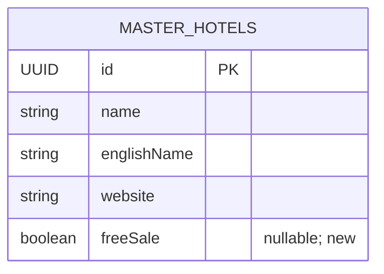

# HOTEL-IMPORT-COLUMNS-1020

PC-B; branch codex/pc-b-hotel-import-columns-1020. User explicitly authorizes push and develop merge after tests (follow-up confirmation20 October).

## Mapping and compatibility

Extend the supplied14-column template with O=وب‌سایت, P=فروش آزاد, Q=نام فارسی. Preserve the existing sheets/header row/styles and blank input rows; no invented sample information. Website maps to existing MasterHotel.website; Persian name maps to existing name while نام هتل retains englishName. Without Persian name creation falls back to the supplied hotel name. New nullable freeSale is independent reference metadata, not active status, saleable reference, featured/Sales statistics or an inventory/booking gate. No financial/business workflow changes.

Existing14/18-column workbooks remain accepted. On duplicate UPDATE, omitted new headers preserve saved name/website/freeSale. Explicit blank new fields clear nullable website/freeSale; blank Persian name falls back to hotel name. SKIP remains non-mutating. Name/city remain required and city is bound to the explicitly selected canonical ID; city spelling normalization, signed preview/session, size/OOXML safety, permissions, duplicate policy, atomic commit/CAS and audit remain intact. Optional preview fields are additive for older consumers.

Free sale accepts TRUE/FALSE,1/0, Persian/Arabic digits and بله/خیر, case-insensitive; blank stays null, false never becomes true. Invalid nonblank flags, websites and overlong names yield row/column errors before writes. Domains or http/https URLs up to320 characters are descriptive text and never fetched. Excel auto-generated http(s) hyperlink metadata is accepted only when bound to a Website cell containing the identical address; it is discarded without execution, with a separate ignoredWebsiteHyperlinkCount. Credentials, mismatched targets, other columns, file/javascript targets, other external data, macros and formulas remain blocked. Name limit160; existing content bounds remain. Profile/form permit viewing/editing freeSale and preserve explicit false/null. Existing name and website controls remain.

Actual integration exposed the inherited default5-second interactive transaction limit during a multi-row UPDATE. Commit now uses a bounded120-second timeout/10-second acquisition wait and transaction-local reference tuple caching; all writes/audit retain one atomic transaction and the session claim/CAS. This is not a throughput/SLO guarantee or a relaxation of input/row limits.

## Storage and rollout

Migration20261020180000_hotel_free_sale adds only nullable Boolean freeSale to master_hotels; no data backfill, deletion, index, dependency or unrelated schema edits. Apply this migration after backup before API/Web rollout. Rollback uses the previous compatible app while retaining the additive column/data. No production or3100 rollout, real hotel import, permission grant or operational database writes are part of this task.

The database-designer scoped logical projection found no normalization/type/constraint problems. Existing primary key covers profile lookup; no new index is justified. Existing city-list index is retained (optimizer's unused warning reflects the deliberately bounded single lookup pattern). Its migration-generator feasibility helper fails internally with `Object of type Column is not JSON serializable`; this is not successful migration validation. Prisma validation and actual disposable PostgreSQL migrations/persistence are the verification authority.

## Verification

88 distinct focused tests pass:76 API parser/service/permission/accommodation,3 actual PostgreSQL format/persistence and9 Web/English coverage. Actual preview/commit/profile reread succeeds for legacy18/reduced14/extended17 formats, false/true/null flags, website/Persian-name persistence, old-header UPDATE preservation, later manual edit/clear and duplicate SKIP. All179 migrations applied successfully to disposable QA only. Prisma format/validate/generate, API types and scoped lint pass. Final commit service options regressions5/5 rerun after timeout/cache refinement. English coverage exceeded30s under host contention, then all9 passed with90s CLI allowance; test policy unchanged. Initial local tooling encountered host paging-file exhaustion; no peer processes/services were stopped.

Extended workbook rendered/visually inspected; save/reopen verifies original14 columns and guide values unchanged and the new O/P/Q headers present. Exact-head full hosted quality/build/tests/database gates precede authorized merge, with final evidence on the PR. Browser/live-site acceptance and production deployment must not be inferred.
