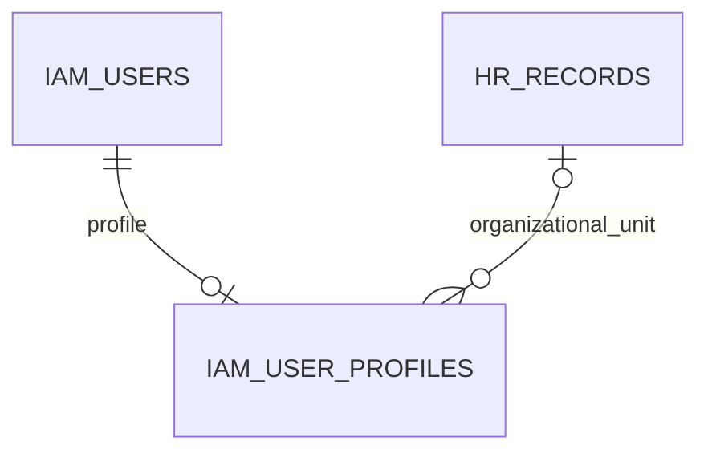

# User organizational-unit assignment — PC-B

Owner authorizes optional selection of a real HR unit for new/existing accounts and push/develop merge. Direct execution without Worker Orchestrator or agents. Existing modular-monolith/PostgreSQL architecture, internal account data, branch tenancy and deployment/recovery policy remain unchanged; no invented QPS/SLO or new platform choice.

## Ownership and storage

HR owns the new minimal HrUserUnitDirectory public port. It returns only ID, branch and name of active non-deleted organization/units records in the operator's IAM branch scope. Native users.manage is required; no HR personnel/payroll access is granted. IAM imports a database-only HR directory module, avoiding the existing HR→IAM dependency cycle. IAM never directly queries HR persistence.

Add nullable UUID organization_unit_id on existing iam_user_profiles, with a real restrictive FK to hr_records and a supporting index. No old accounts/profile rows/employee files/roles/permissions are backfilled or rewritten. Optional profile association is independent of HR personnel employment records. Names come from the live HR directory rather than a duplicated text snapshot.

Each account has at most one selected unit; a unit can be selected by multiple accounts. Reuse existing UUID and query/index conventions. Prisma format/validate/generate and API/Web types pass. Supplementary schema analysis found no normalization/constraint/type issues on the focused relationship projection. Its JSON parser ignores indexes, so verify the FK index in actual Prisma/migration SQL and PostgreSQL instead. The supplementary migration generator has an internal Column serialization error; it is not used as evidence of successful migration. Existing Prisma/hosted PostgreSQL validation is authoritative.

## Commands and preservation

Creation accepts optional organizationUnitId. With a selected unit, use one transaction for live operator status/permission/branch recheck, operator/unit locks, HR resolution and account/profile creation. Reject invalid/inactive/deleted/non-unit/out-of-scope selections before account creation. Creating without a unit preserves the old contract. Unit selection never gives roles/permissions.

PATCH /iam/users/:id/details adds optional organizationUnitId; omission preserves current unit and explicit null clears it. Existing revision includes unit ID, so stale unit-only writes conflict. Recheck live authority and intersect target/operator branches; lock the unit against concurrent HR change. Upsert only the unit field, preserving profile phone/photo, and audit with the user-name update atomically. Name-only saves preserve inactive/unavailable units without silently clearing them. Saving account branches cannot remove the assigned unit's branch: explicitly clear/reassign first. Existing manual-role/grant/CAS/last-manager guards are untouched.

GET /iam/users/organization-units uses the existing account-management guard and public HR port. The new-user form and existing-user details editor use the shared searchable selector, filtered by the account's saved/selected branches. Offer explicit no-unit selection, retain unavailable current IDs without inventing labels or clearing on open, and disable editing for read-only/pending forms. On new-user branch removal, discard only an unsaved invalid unit draft. Existing-user branch edits and details saves remain separate. English/offline catalogues synchronized.

## Migration and rollback

20261018110000_iam_user_organization_unit is additive only: nullable column, FK and index. Apply before the new application. Existing versions ignore the column; application rollback keeps it and its selected IDs, avoiding data loss. A later schema rollback must first export selected IDs, then remove FK/index/column only with explicit approval; no down/destructive operation or operational migration is executed by this task.

Add a focused hosted PostgreSQL gate. It checks the actually migrated nullable UUID/FK/index and runs the same migration against connection-local temporary legacy profile/HR tables. Prove legacy data preservation, assignment/clear, rejection of nonexistent references, restrictive unit delete and live rename lookup. Guard the test to explicit opt-in and local disposable nora_ci/iam_unit_test databases; never mutate permanent account rows.

API/HR tests cover old creation, live operator checks, scope/active filtering, invalid choice/no write, unit set/clear, name-only preservation, stale revision, guarded HTTP UUID/DTO contracts and branch retention. Web tests cover scoped choices, ID callbacks, read-only/empty/current-unavailable states and existing IAM/i18n regressions. Full final-head quality/test/build/PostgreSQL gates must pass before owner-authorized develop merge. No deployment or operational DB/user/role mutation.
